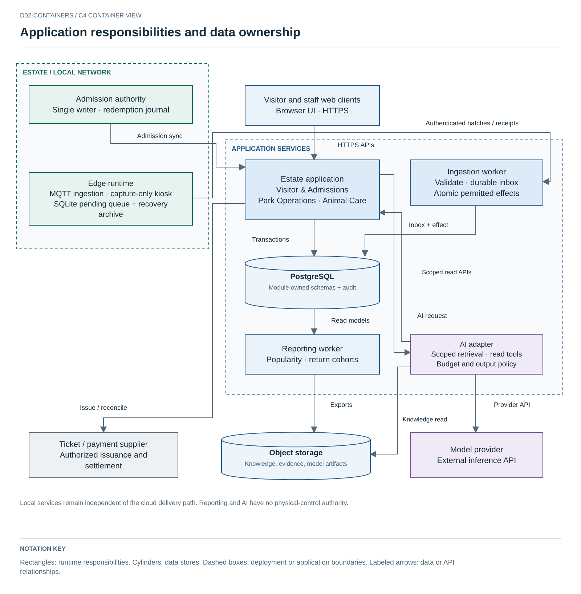
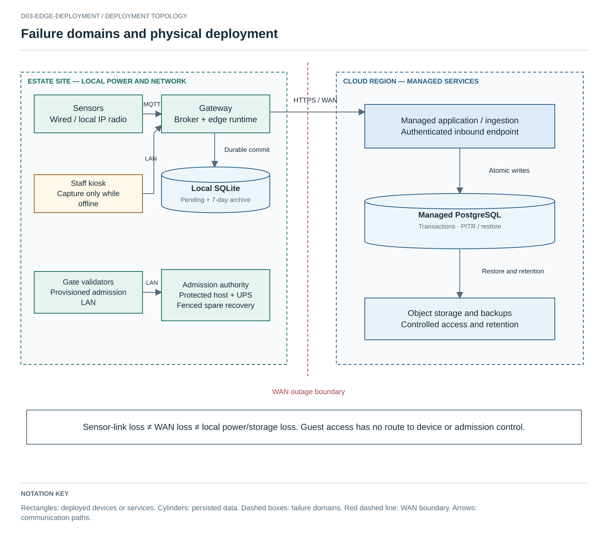

# Architecture

**Architecture version:** 2026-09-17 · **Scope:** one estate, phased digital modernization.

## 1. Operating model

ATLAS digitizes visitor admission and estate operations without requiring every process to contact the cloud. Three business modules own **Visitor & Admissions**, **Park Operations**, and **Animal Care**. Edge telemetry, identity, analytics and the AI adapter support these modules; they are not assumed to be independent business domains.

Cloud functionality begins as a modular application with explicit interfaces and schema ownership. A managed PostgreSQL deployment stores transactional state; object storage holds exports, approved knowledge artifacts and versioned model/evaluation artifacts. A durable ingestion worker writes an inbox and operational effects transactionally before acknowledging an edge batch. A scheduled reporting job produces aggregate views. There is no requirement for Kafka, Spark, a service mesh or a separate feature store in the initial release.

The cloud deployment is described by required capabilities, not a list of interchangeable brand names: managed container execution, PostgreSQL with backup/restore and availability options, object storage, and secret/key management. Supplier/region selection is an implementation procurement decision after jurisdiction and team capability are confirmed. The topology and data ownership do not depend on that later commercial choice.

Editable native drawings and exported SVG/PNG views are included; no drawing replacement is required.

## 2. Containers and authority

| Container/capability | Responsibility | State and authority |
|---|---|---|
| Visitor web application | Ticket flow, pass display, approved park information, assistant UI | Minimal local cache; never authoritative for price, payment or admission. No native mobile application required initially. |
| Staff web application | Observations, care review, work orders and popularity views | Authenticated role-specific UI; capture-only local observations through an edge-served kiosk where a staff LAN is provisioned; no new offline digital care authorization. |
| Estate application | Three business modules, operational APIs, read models and authenticated care transitions | PostgreSQL schemas owned by modules; business changes plus outbox events in one transaction. |
| Edge runtime | Local MQTT ingestion, event identity, durable outbox, prioritized upload, local status | SQLite WAL; edge owns accepted events until final destination acknowledgement. |
| Admission authority | Redemption for a declared admission domain (initially the main entrance) | Local single writer/leader and redemption log; cloud reconciles after outages. Separate from general telemetry. |
| Ingestion worker | Validate schemas, apply durable inbox uniqueness, update permitted operational state | Durable receipt and business effect in a transaction; repeated identity with different payload is rejected. |
| Reporting worker | Aggregate popularity, cost and operational trends | Derived data only; failures do not block admissions or urgent care. |
| AI adapter | Versioned internal contract, retrieval, cost reservation, provider adapter, output policy | Model configuration, approved corpus versions and evaluation artifacts; read-only tools. |
| Ticketing/payment integration | Payment intent, issuer workflow, refunds, settlement and vendor adapters | Provider settlement is authoritative for payments; ATLAS reconciles using idempotent references. |

The diagram is a logical container view. Physical deployment, power, device links and WAN boundaries belong in the deployment view rather than being inferred from C2 boxes. [C4 guidance](https://c4model.com/diagrams)

## 3. Physical edge and connectivity

The initial planning assumption is **25 active gateways and 5 spares at full rollout**, preceded by a **4-gateway pilot with one spare**. This is not a surveyed estate layout. Each site needs a recorded sensor inventory, power source, storage class, local link and backhaul. IP-capable devices use MQTT over an appropriate wired/local wireless link; non-IP sensors need a named physical adapter. LoRaWAN is an option for a separate low-rate feasibility investigation, not a claim that raw MQTT/TCP runs directly over every radio.

Guest Wi-Fi cannot reach staff or telemetry networks. Logical segregation and filtered routing are documented as such, not as an air gap. Cloud ingestion receives outbound authenticated connections; model providers receive only the minimum permitted input through the AI adapter. Local safety/protection systems are outside this proposal's generic software authority and must not depend on cloud telemetry or the assistant.

Three distinct failures matter: a sensor cannot reach its gateway; a gateway cannot reach cloud; or the gateway loses power/storage. Store-and-forward addresses the second condition and some recoverable process failures. It cannot recover a reading never acquired, a destroyed disk, or an unavailable staff LAN.

## 4. Consistency and state changes

Events use stable identities and explicit aggregate sequence/epoch information. The edge persists before application-level acceptance. A broker acknowledgement is not an assurance that cloud business processing completed. Cloud ingestion deduplicates against durable records and issues final application acknowledgement after commit. Physical collection transfers custody to an authenticated carrier; the source retains data until it has the final receipt or a separately reviewed replicated-custody policy. [ADR-002](adrs/adr-002-store-and-forward-edge-storage.md)

Ticket authenticity is verified with public-key signatures; signatures alone do not prevent reuse. The main entrance operates one local redemption authority reachable over a provisioned admission network. If isolated gates cannot reach it, automatic redemption stops and staff apply the logged exception process. This sacrifices some throughput to avoid pretending that disconnected independent validators can coordinate single-use state. [ADR-008](adrs/adr-008-offline-ticketing-and-reconciliation.md)

Care commands validate actor role and a task/action/version-specific approval. An approval and its audit record commit together; an action attempt and its reported outcome are recorded separately. Notification/escalation can proceed without authorizing treatment. A change to the underlying observation invalidates an approval for an older version. [ADR-006](adrs/adr-006-human-in-the-loop-animal-care.md)

## 5. AI placement

The first AI trial is a grounded visitor assistant using approved information and freshness-aware read tools. Animal anomaly and population-counting trials keep estimates separate from keeper-confirmed facts. Predictive maintenance remains conditional on label quality, representative sensor features and demonstrable benefit over threshold/manual inspection. [Use-case designs](design/ai-use-cases.md)

No LLM, CV model or traditional ML model has permission to move barriers, execute treatment, issue a ticket or change a price. A deterministic permission check is required even when an AI output is valid JSON. Existing protection/inspection authority is neither replaced nor certified by this proposal.

## 6. Evolution and operational limits

Use managed availability features and tested restore procedures before assuming a second region. Service extraction is triggered by independent scaling/deployment or fault-isolation evidence; a lakehouse is triggered by data/query needs beyond the simple operational/reporting design. Locally hosted LLMs require a separate hardware/support/cost evaluation. None is an initial dependency.

[Quality targets](requirements/assumptions-and-targets.md), [degraded modes](design/degraded-modes.md), [operating controls](design/security-and-operations.md), [capacity/costs](design/capacity-and-costs.md) and [evaluation](validation/evaluation-plan.md) define the limits of these choices. No universal zero-loss, zero-risk or all-services-offline guarantee is made.

## 7. Recovery contracts

Admission remains a single-writer service. Recovery on a warm spare requires fencing the former primary, a verified redemption journal and a new authority generation. If committed redemption state is uncertain, remain in staffed exception mode until reconciliation. There is no automatic active-active failover.

After final destination receipt, acknowledged observation events move to a separate seven-day edge recovery archive. Replay original identities after a cloud restore. Pending capacity and archive expiry are managed separately. This improves observation recovery but does not recover destroyed gateways or lost cloud-only financial/care transactions; point-in-time recovery and domain reconciliation remain required.

Offline staff kiosks capture observation drafts with expiring capture-only roles. New care approvals/execution authorizations require the cloud authority and current task state. Existing emergency procedures operate independently.

## Detailed authority contract

See [authority recovery and care outcomes](design/authority-recovery.md) for fencing and validator enrollment, twelve-hour capture grants, revoked draft quarantine, and completed/failed/unknown physical outcomes. The 72-hour telemetry buffer is separate from authenticated staff access.

## Visitor discovery contract

The [worked visitor journey](design/visitor-assistant-contract.md) defines PostgreSQL full-text retrieval, confirmed constraints, candidate IDs, deterministic fact rendering, evaluated language support and budget failure behavior. General information uses approved excerpts; unconstrained generated prose is outside the initial public product.

### Fit with existing systems and controlled introduction

The brief provides existing physical operations and recently inspected rides, but **no existing software topology**. ATLAS does not assume that the estate already runs PostgreSQL, a ticketing platform or a particular cloud. Discovery inventories current ticket/pass products, payment settlement, animal ledgers, maintenance records, device interfaces, staff roles and data-export rights. Existing physical protection, inspections and emergency procedures remain independent of ATLAS.

| Step | Introduction and acceptance | Rollback boundary |
|---|---|---|
| Discover contracts | Record authoritative owners, identifiers, supported interfaces and data quality; select suppliers against offline redemption, timed entry and export requirements | Keep incumbent/manual operation if no acceptable integration exists |
| Import and reconcile | Map legacy/manual IDs explicitly; preserve original units, timestamps, author and uncertainty; compare ticket allowances, financial references and animal balances with source totals | Quarantine ambiguous records; never invent missing animal or financial facts |
| Shadow | Capture observations and produce comparison views without changing operational authority; staff review missingness, duplicate records and workflow effort | Stop capture/integration and retain existing procedures |
| Pilot cutover | Select one entrance domain and a limited care-record scope; explicitly transfer the relevant write authority after reconciliation and staff rehearsal | Do not run two independent redemption writers. On failure, stop automated redemption and reconcile its journal before returning authority |
| Expand selectively | Apply the evaluated contracts to the next site/capability; retain original-ID mappings and an export path | Roll back the failed capability rather than the whole estate; preserve accepted records and audit |

Availability, consistency and latency differ by boundary: local admission requires one writer; observations tolerate delayed cloud delivery; care approvals require current authority; reporting and AI may degrade to baseline. Integrations use versioned contracts rather than direct cross-system table writes. A legacy supplier that cannot support these semantics changes the integration decision and scope; it is not made compatible by drawing an adapter box.

## Business and model operation

[Visitor growth and popularity](design/visitor-growth-and-popularity.md) specifies acquisition, saved return plans, independent reminder consent, 90-day cohorts and calibrated entry-rate reporting. [AI operations](design/ai-operations.md) specifies production sampling, triggers, ownership and rollback. These use the existing business modules, reporting worker and adapter.
