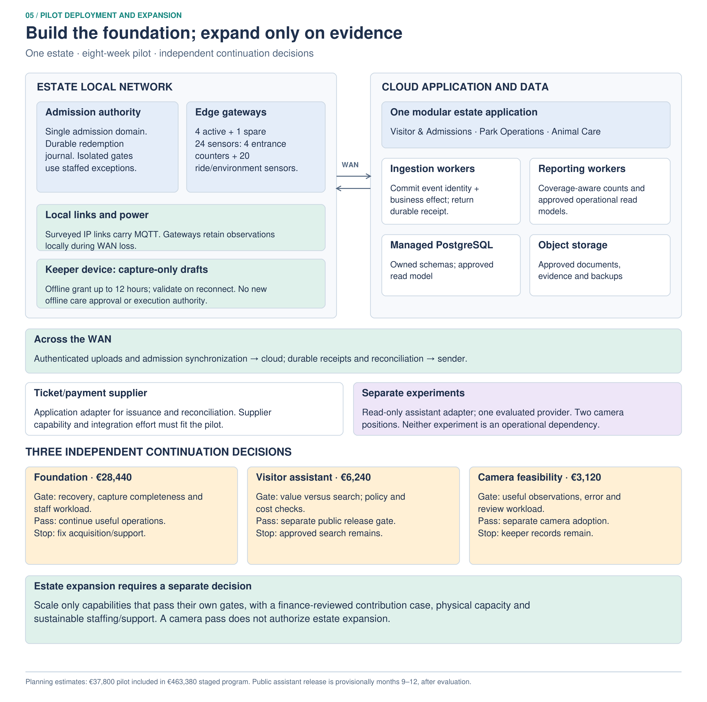
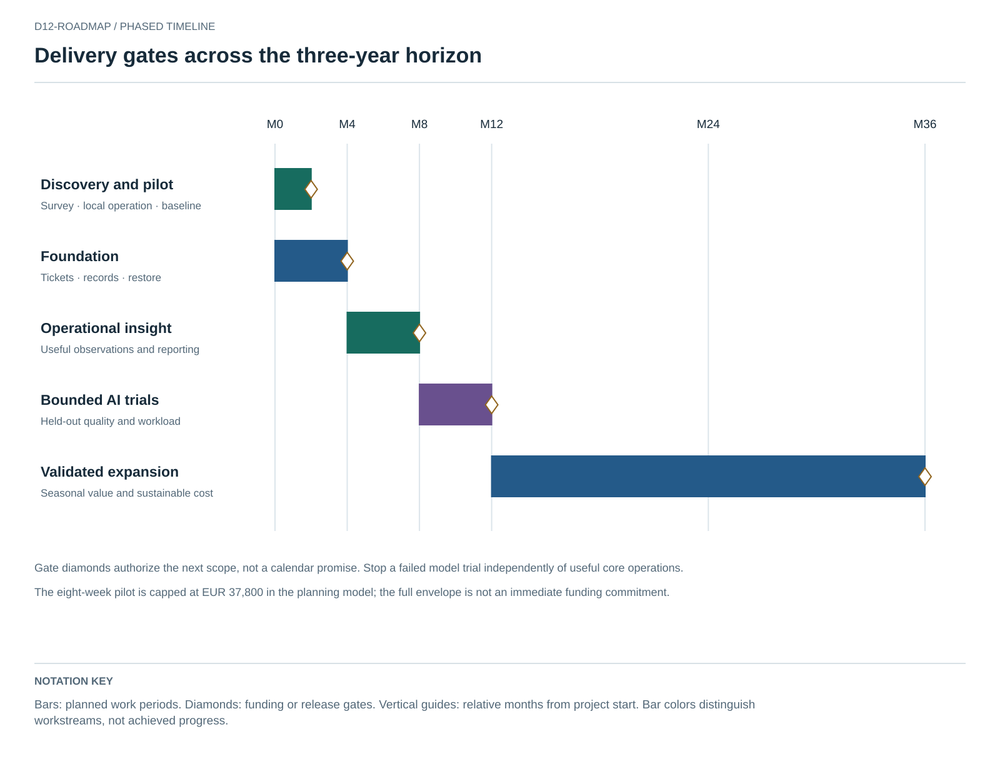

# Implementation roadmap

Camera evaluation can authorize a separate animal-monitoring adoption decision. It does not authorize program expansion; finance, estate capacity and support gates remain independent.

These are suggested business implementation windows, not the kata preparation dates. The three-year visitor target is an aspiration from the brief; software does not guarantee attendance or safe physical capacity. Every stage includes training, accessibility, security, monitoring, verification and rollback.

| Stage | Scope and owner | Exit evidence | Stop / rollback |
|---|---|---|---|
| Discovery, weeks 1–4 | Lead + field/operations: process, power/link/site survey; supplier capability; data/label inventory; staff roles and costed pilot | Feasible local operation, approved workflows, named support, baseline metrics | Redesign if power/connectivity/support cost makes pilot infeasible. |
| Foundation, months 1–4 | Ticket/family-pass integration, local redemption authority, 4+1 gateway pilot, keeper records, basic popularity, identity/audit/restore | Reconciled admissions/observations through agreed outages; manual fallback and staff training exercised | Keep existing processes while correcting failure modes before expansion. |
| Operational insight, months 5–8 | Expand useful sensing; data quality; feeding/population review; popularity and work orders; baseline maintenance | Staff use records in decisions; meaningful coverage, acceptable support/alert workload | Reduce noisy sensing/alerts; fix acquisition/ownership before adding models. |
| Bounded AI, months 9–12 | Grounded visitor assistant; conditional animal anomaly/counting; conditional maintenance shadow trial | Baseline comparisons, representative held-out data, human promotion, cost/degradation/rollback reviewed | Remain on search/manual/threshold baseline if benefit or quality insufficient. |
| Expansion, months 13–36 | Scale validated capabilities; improve repeat-visit cohorts and operations; optimize only when justified | Seasonal outcomes, sustainable unit costs, field capacity and actual staffing | Stop ineffective features; avoid unproven multi-region, multi-estate and RL scope. |

## Business measures

Define repeat-visit rate by a declared cohort/window with privacy-aware linkage where appropriate; family-pass renewal and actual visits are different measures. Track contribution margin and avoid double counting attendance/price/renewal effects. Track keeper review time, observation coverage, missed/false alerts and operational response—not an unsupported promise of zero incidents. Popularity reporting should lead to a named staff/investment decision.

The [cost model](design/capacity-and-costs.md) includes delivery and support. Obtain vendor/installation estimates after the pilot design. Funding approval is staged, with contingency and a clear stop decision with no unmeasured payback promise.

## Pilot scope and release contract

Run an eight-week pilot inside the foundation window, with a proposed EUR 37,800 ceiling allocated from the full envelope. Scope: one admission domain, four gateways plus one spare, 24 sensors, two experimental camera positions, local observation drafts and visitor-assistant evaluation. Do not expand until outage/replay, fenced authority recovery, capture completeness and staff workload are acceptable. Approve camera/AI expansion independently using representative quality and cost evidence. Budget details are in [the cost model](design/capacity-and-costs.md).

## Funding by decision

### Staged investment and independent stop decisions

The immediate proposal is an **eight-week pilot capped at EUR 37,800**, allocated within the overall program. All amounts are planning estimates, not supplier quotes or approved spending. The pilot includes discovery, one admission domain, four active gateways plus one spare, 24 sensors, capture-only care drafts, a visitor-assistant sandbox and two experimental camera positions.

| Pilot package | One-off including 20% contingency | Two-month operation | Ceiling | What remains if stopped |
|---|---:|---:|---:|---|
| Operational foundation | 25,200 | 3,240 | **28,440** | Local admissions, structured observations, replay and search remain the primary deliverable |
| Visitor assistant experiment | 6,000 | 240 | **6,240** | Approved search, filters and static information remain available |
| Camera feasibility experiment | 3,000 | 120 | **3,120** | Keeper records and manual observation remain available |
| **Pilot total** | **34,200** | **3,600** | **37,800** | Stop either experiment independently |

The foundation allocation comprises EUR 4,750 hardware/networking, 18 delivery days, four installation days, two training days, three data-preparation days and one specialist day. The assistant uses six delivery days, two data days and half a specialist day. The camera trial uses EUR 1,000 hardware, one delivery day, one installation day and half a specialist day. These reconcile to the original 25/5/2/5/2 pilot person-day totals. Shared delivery tools and existing staff availability are assumptions; if supplier integration cannot fit, narrow the pilot before approval rather than silently increase scope.

| Stage | Months | One-off allocation | Monthly operating estimate | Release condition |
|---|---:|---:|---:|---|
| Pilot | 1–2 | 34,200 | 1,800 | Fund only the bounded scope above |
| Foundation | 3–4 | 50,000 | 3,000 | Useful local admission and records; recovery and workload acceptable |
| Insight | 5–8 | 60,000 | 4,500 | Measurable capture quality and manager use; replace installation assumptions with estimates |
| AI release gates | 9–12 | 50,000 | 6,000 | Promote useful evaluated capabilities; exclude failed experiments from subsequent scope |
| Conditional expansion | 13–36 | 32,780 | 7,700 | Finance-reviewed contribution case and sustainable staffing/support |

The one-off allocations sum to EUR 226,980 and include the pilot; do not add it again. Staged operation totals EUR 236,400, producing **EUR 463,380 over 36 months** if every stage is funded. The all-months-at-full-capacity calculation provides a conservative sensitivity case: **EUR 504,180**, EUR 40,800 above the staged case. Neither is an unconditional commitment or a confidence interval.

Under the explicitly assumed month-13 benefit start, 24 months of contribution at EUR 5,000 / 12,000 / 18,000 yields EUR 120,000 / 288,000 / 432,000. Against staged costs, net differences are **−343,380 / −175,380 / −31,380**. Staged break-even requires approximately **EUR 19,307.50 incremental contribution per benefit month**. The full-capacity sensitivity case requires EUR 21,007.50. These scenarios do not establish payback; earlier operational benefits are deliberately not monetized without a basis.

The pilot purchases information needed for the next decision: whether reliable capture reduces rework, whether usable local admissions can be supported, whether visitors complete tasks more easily than with search, and whether cameras can observe a meaningful quantity. The operations lead evaluates foundation value separately from model results. Finance must replace cost and contribution assumptions with supplier/support estimates, margins, adoption and seasonality before expansion. Welfare and continuity benefits may justify some spending, but are not assigned invented monetary values.

### Selected admission demand policy

Retain twelve lanes as a **planning assumption** and use timed entry capped at **1,500 people per fifteen-minute slot**, including walk-ups. At the simplified five-second service time, theoretical slot capacity is 2,160 people; the selected cap leaves approximately 31% headroom. Scheduling 15,000 people at that cap takes at least 2.5 hours, rather than promising to admit them all in one hour. Tickets count people/party allowance, not just QR scans. Preserve accessible lanes and a separate exception desk; do not route long exception handling through ordinary lanes.

The entrance supervisor owns the release cap. Before launch, measure full passage times and bursts, confirm safe queue space and check party/re-entry behavior. Proposed acceptance: under the agreed arrival profile, p95 queue wait below ten minutes, no overflow of domain-approved queue capacity, and sustainable staffing. These are unmeasured operating targets. When lanes fail, reduce future slot releases according to remaining effective capacity, communicate delays for already booked arrivals and use the staffed queue plan. API latency alone cannot satisfy this gate. Timed-entry controls are a ticket-supplier selection requirement; a supplier that cannot enforce the cap needs a scoped integration or a revised decision.

The visitor sandbox belongs to weeks 1–8; public release is a separate gate, provisionally months 9–12. A successful sandbox does not authorize public rollout.

## Scope allocation and transition gates

Four of the 24 pilot sensors are non-identifying attraction entrance counters, with manual calibration; twenty cover selected ride/environment observations. The hardware and installation ceiling remains unchanged: substitute manual sampling or narrow sites if the allocation is infeasible. Foundation work includes approved public pages, basic checkout instrumentation and saved return plans; reminder delivery is conditional on existing supplier capability and the stated service/support allocation. These are backlog allocations, not added uncosted platforms.

Cutover follows [coexistence and migration](design/coexistence-and-migration.md): inventory, import/reconcile, shadow, transfer one authority and expand. Public AI release also requires the [production monitoring and response](design/ai-operations.md) owner to exercise feature disablement, source withdrawal and provider failure. The 90-day return measure requires complete follow-up; the eight-week pilot cannot claim that result for its last entrants.
