# ATLAS — Von Digitalis Estates

### O’Reilly Architectural Katas 2026 · AI-Assisted Software Architecture

**Dependable estate operations. Useful visitor assistance. Explicit authority.**

| Team ATLAS | Role | Profile |
|---|---|---|
| Mihir Joshi | Engineering Manager | [LinkedIn](https://www.linkedin.com/in/mihirjoshi21/) |
| Trenton Jones | Architect | [LinkedIn](https://www.linkedin.com/in/trentonjones/) |
| Kyle Eckert | Senior Product Manager | [LinkedIn](https://www.linkedin.com/in/kyle-eckert96/) |

## Final submission video

▶️ **[Watch the ATLAS final submission video (Atlas.mp4)](Atlas.mp4)**

## Executive overview

The Countess needs an estate that can serve more visitors while making better decisions about its rides, animals and staff. Tickets and family passes must work at the entrance. Keepers need dependable feeding, health and population records. Managers need to know which parts of the estate are popular, and visitors need useful information that encourages a return visit. Patchy Wi-Fi makes a cloud-only solution a poor starting point.

ATLAS combines **local admission authority and durable edge collection** with **a small cloud application** organized around three business capabilities: Visitor & Admissions, Park Operations, and Animal Care. We buy commodity payment/ticketing capabilities where a supplier meets the integration contract, and build the estate-specific workflows. Local MQTT carries acquired observations; a persistent outbox holds them during backhaul outages. Cloud ingestion records event identity and its business effect together before acknowledging delivery. Old information is visibly old, rather than silently presented as current.

The first AI investment is a bounded visitor-discovery trial: natural-language selection of suitable activities, with authoritative facts rendered by ordinary software. AI is targeted at decisions where uncertainty can be handled explicitly. A grounded visitor assistant selects activities from approved information and current status; the application enforces confirmed visitor constraints and renders approved facts. Animal-care models can rank observations or estimate population counts, but keepers confirm the record and authorized humans approve care. Maintenance prediction is a conditional extension after useful labels exist. None of these models can issue tickets, change prices, authorize treatment or control physical protection. Each has a non-AI baseline, a promotion gate and a useful fallback.

Our central tradeoff is intentional: **we accept reduced convenience during failure in return for explicit authority and understandable recovery.** An isolated gate uses a staffed exception procedure; an assistant without fresh evidence falls back to approved information; an unproven model stays in shadow mode. The proposal can evolve without making the estate depend on a successful AI prediction.

**Business path:** approved attraction pages support first visits; clear checkout converts interest into attendance; optional saved return plans and separately permitted reminders support repeat visits. Anonymous entry observations guide staffing and investment. AI assists discovery and reviewed observations; measured business outcomes determine whether it is retained.

**Investment decision:** start with the EUR 37,800 pilot: EUR 28,440 operational foundation, EUR 6,240 visitor-assistant experiment and EUR 3,120 camera feasibility. The experiments have independent stop decisions. Conditional full expansion is EUR 463,380 under staged operating assumptions; the illustrative benefit cases do not yet justify it. The pilot must establish the basis for further investment.

[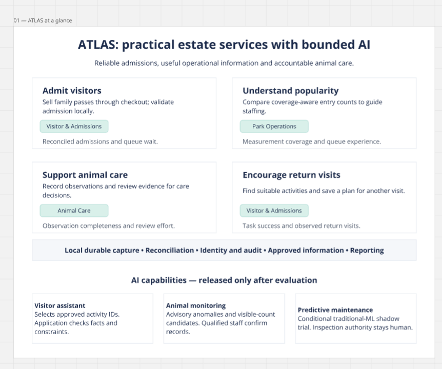](diagrams/rendered/v01-atlas-overview.png)

<details>
<summary>System context and external actors</summary>

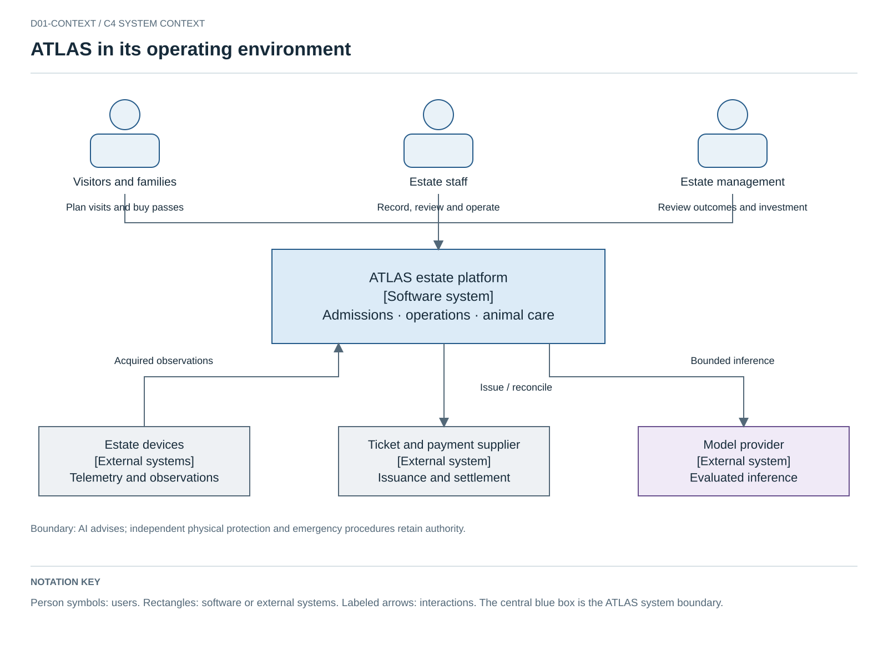

</details>

### Architecture guide

[1. Brief and scope](#1-brief-and-scope) · [2. Goals and assumptions](#2-goals-and-assumptions) · [3. Architecture](#3-architecture) · [4. Business workflows](#4-business-workflows) · [5. AI design](#5-ai-design) · [6. Decisions and alternatives](#6-decisions-and-alternatives) · [7. Data and consistency](#7-data-and-consistency) · [8. Failure and security](#8-failure-and-security) · [9. Validation and evidence](#9-validation-and-evidence) · [10. Capacity and cost](#10-capacity-and-cost) · [11. Delivery and outcomes](#11-delivery-and-outcomes) · [12. Risks and revisit triggers](#12-risks-and-revisit-triggers)

**Start here:** overview → [worked visitor example](#51-grounded-visitor-assistant) → [investment decision](#103-staged-investment-and-independent-stop-decisions) → [evidence](#9-validation-and-evidence). The full architecture, diagrams and decisions are retained below. 

## 1. Brief and scope

Von Digitalis Estates has **40 rides, over 200 animals across 55 displays/enclosures, and average attendance of 5,000 visitors per day**, with an aspiration to reach **at least 15,000 within three years**. Animal count is not species count. The estate has patchy Wi-Fi; cloud use is permitted if there is a transmission path, and budget is available for MQTT-capable devices. These are the business constraints. Device quantities, software budgets and service targets below are our planning assumptions.

| ID | Need from the brief | ATLAS response | How success would be assessed |
|---|---|---|---|
| R01 | Tickets and family passes | Bought payment/issuance integration, signed entitlements, local redemption and reconciliation | Correct party/admission/refund behavior, including outages |
| R02 | Popularity to guide staffing and investment | Non-identifying entry counts per covered operating hour, calibrated by manual samples; recorded staff decisions | Agreement with sampled counts and usefulness to actual staffing decisions |
| R03 | Monitor animal health | Structured observations, review tasks and optional anomaly assistance | Observation coverage, missed/false alerts and response workload |
| R04 | Understand how much and how well animals eat | Offered/remaining/estimated-consumed records with units, time and quality | Useful keeper-reviewed feeding history; uncertainty visible |
| R05 | Monitor piranha population levels | Keeper ledger plus conditional vision-assisted observations | Reconciled counts, error/undercount analysis and review effort |
| R06 | Grow average attendance toward 15,000/day | Capacity planning for APIs, admissions, staff and physical estate separately | Measured peak flow and service capacity, not API latency alone |
| R07 | Improve profitability | Staged funding, contribution measures and full cost model | Incremental contribution against operating and delivery cost |
| R08 | Increase returning visitors | Saved return plans, optional reminders, family passes and bounded discovery | Repeat-visit cohorts, pass renewal and visitor task completion |
| R09 | Operate with patchy Wi-Fi | Provisioned local links, local authority, bounded buffering and manual fallbacks | Separate link, WAN, power and storage failure exercises |
| R10 | Use cloud with an estate transmission path | Authenticated outbound batch upload and recovery receipts | Accounted-for accepted events and visible stale/cloud state |
| R11 | Use the available MQTT-device budget | MQTT on supported local IP links, with explicit adapters where needed | Field connectivity/power/operability pilot |
| R12 | Appropriate AI-assisted architecture | Focused AI use cases, alternatives, uncertainty and verification | Usefulness versus baselines and a defensible decision trail |

The initial boundary is **one estate**. We do not include autonomous treatment, automated containment, dynamic reinforcement-learning prices, multi-estate expansion or a complete replacement of established physical protection. Clinical thresholds, ride capacity and emergency procedures remain the responsibility of appropriate domain authorities.

## 2. Goals and assumptions

We prioritize **operational continuity, data integrity, clear authority and useful information**, followed by maintainability and cost. Availability does not mean every function remains available in every failure: payment authorization, fresh cloud facts and fully isolated automatic admission have limits.

| ID | Selected design assumption or target | Boundary and consequence |
|---|---|---|
| A01/A02 | One estate; local admission/staff links can be provisioned | Survey before installation. Cloud disconnection is different from losing the local LAN. |
| A03 | Buffer summaries for a 72-hour WAN outage | Assumes working power, storage and sensor-to-gateway links; bounded by provisioned capacity. |
| A04/A05 | Pilot 4 gateways + 1 spare; full planning case 25 + 5, 350 sensors and 60 candidate cameras | Quantities are provisional, not a surveyed installation. Camera usefulness is tested before scale. |
| A06 | Event payload at most 1,024 bytes; assumed average 500 bytes | Large evidence/footage follows a separate object pathway. |
| A07 | 15,000 visits/day, 10 opening hours, 20 API calls/visit and 10× burst | Used for arithmetic, not claimed observed traffic. |
| T01 | Operational API p95 server response below 300 ms | Excludes external payment/model latency; requires a declared load test. |
| T02 | Local validation plus redemption p95 below 250 ms | Excludes people walking through gates and exception handling. |
| T03/T04 | Assistant p95 below 4 s, 5 s deadline; live status older than 2 min marked stale | Fall back when the request or information cannot meet its contract. |
| T05 | Cloud availability target 99.5% monthly; disaster RPO at most 15 min, RTO at most 4 h | Proposed operating objectives. Disaster restore can lose recent cloud records; ordinary replay deduplication is not a zero-loss DR guarantee. |
| T06 | USD 50/day cloud AI ceiling, accounted in UTC | Atomic maximum-cost reservation, bounded retries and fail-closed calls if budget authority is unavailable. |
| A08/A09 | Representative model labels and domain thresholds are not yet established | Establish them before model promotion or consequential operational use. |
| A10 | One main-entrance redemption authority | Isolated gates move to staffed exceptions rather than competing independent writers. |
| A11/A12 | EUR planning currency; minimized retention | Illustrative FX only. Default summaries 90 days, aggregates 13 months, AI diagnostics 7 days; required audit/transaction retention needs its own policy. |
| A13/A14 | Seven-day acknowledged-observation archive; eight-week pilot ceiling EUR 37,800 | Archive storage is separate from pending-outage capacity; pilot spending is allocated within the full envelope. |

These are explicit design choices to validate. No requirement is met by assigning a number alone. [Full target register](requirements/assumptions-and-targets.md)

## 3. Architecture

### 3.1 Small cloud core, distinct edge responsibilities

ATLAS starts with a modular application, a managed PostgreSQL store, object storage, a durable ingestion worker, scheduled reporting, and an AI adapter. Visitor & Admissions, Park Operations and Animal Care own their schemas and interfaces. Separate worker/runtime boundaries exist where deployment, connectivity or permissions differ; this does not require a microservice for every noun.


| Capability | Responsibility | Authority and state |
|---|---|---|
| Visitor web application | Ticket purchase flow, pass display, approved information and assistant UI | Minimal local cache; cannot set prices or approve admissions |
| Staff web application | Observations, reviews, work orders and popularity | Role-specific access; offline reachability requires a provisioned local terminal/network |
| Estate application | Three business modules and operational APIs | Module-owned relational state; changes and outbox events commit together |
| Edge runtime | MQTT ingestion, persistent outbox, upload, local health and freshness | Owns accepted pending records until matching final destination receipt |
| Admission authority | Atomic local redemption for a declared admission domain | Local single writer/leader and audit log, separate from telemetry |
| Ingestion worker | Source/schema validation, durable identity check and permitted effect | Inbox uniqueness plus business effect in one transaction |
| Reporting worker | Aggregate popularity, operational trends and exports | Derived information; cannot block admissions or urgent care |
| AI adapter | Approved retrieval, read tools, request limits, provider contract and policy | No ticket, price, treatment or actuator write authority |
| Ticket/payment integration | Issuance, payment references, refund and settlement reconciliation | Provider settlement is authoritative for payment; integration is idempotent |

We **buy** payment processing, identity and suitable ticketing capability; we **build** estate-specific observations, review/reconciliation and the integration contract. Buying is conditional on offline entitlements, APIs/webhooks, export and reconciliation support. If a supplier cannot provide the required contract, replace that component or build the narrow issuance integration; do not remove the offline requirement to accommodate it.

Deployment uses managed container execution, PostgreSQL with backup/restore and availability options, object storage and managed secrets. A cloud brand is intentionally not the architectural decision: jurisdiction, supplier compatibility and operating capability must decide region/provider. The selected topology, data ownership and failure contracts are concrete despite that procurement choice. Kafka, Spark, service mesh and a separate feature store are deferred until measured needs justify their operating cost.

### Build-or-buy challenge

| Alternative | Strongest argument for it | Why we select or limit it |
|---|---|---|
| Buy one estate-management suite | Less custom software and a single support contract | Prefer it where it demonstrably meets local redemption, data export and care-review contracts; replace custom modules if the pilot proves that fit. |
| Modular core plus bought payment/identity/ticket capabilities | Keeps domain ownership and offline contracts explicit without many services | Selected baseline; integration and support cost remain visible. |
| Microservices plus streaming/ML platform | Independent scaling and team ownership when those needs are real | Deferred until bottlenecks, isolation or separate delivery teams justify the operational cost. |

### Fit with existing systems and controlled introduction

The brief provides existing physical operations and recently inspected rides, but **no existing software topology**. ATLAS does not assume that the estate already runs PostgreSQL, a ticketing platform or a particular cloud. Discovery inventories current ticket/pass products, payment settlement, animal ledgers, maintenance records, device interfaces, staff roles and data-export rights. Existing physical protection, inspections and emergency procedures remain independent of ATLAS.

| Step | Introduction and acceptance | Rollback boundary |
|---|---|---|
| Discover contracts | Record authoritative owners, identifiers, supported interfaces and data quality; select suppliers against offline redemption, timed entry and export requirements | Keep incumbent/manual operation if no acceptable integration exists |
| Import and reconcile | Map legacy/manual IDs explicitly; preserve original units, timestamps, author and uncertainty; compare ticket allowances, financial references and animal balances with source totals | Quarantine ambiguous records; never invent missing animal or financial facts |
| Shadow | Capture observations and produce comparison views without changing operational authority; staff review missingness, duplicate records and workflow effort | Stop capture/integration and retain existing procedures |
| Pilot cutover | Select one entrance domain and a limited care-record scope; explicitly transfer the relevant write authority after reconciliation and staff rehearsal | Do not run two independent redemption writers. On failure, stop automated redemption and reconcile its journal before returning authority |
| Expand selectively | Apply the evaluated contracts to the next site/capability; retain original-ID mappings and an export path | Roll back the failed capability rather than the whole estate; preserve accepted records and audit |

Availability, consistency and latency differ by boundary: local admission requires one writer; observations tolerate delayed cloud delivery; care approvals require current authority; reporting and AI may degrade to baseline. Integrations use versioned contracts rather than direct cross-system table writes. A legacy supplier that cannot support these semantics changes the integration decision and scope; it is not made compatible by drawing an adapter box.

<details>
<summary><strong>Edge deployment and connectivity detail</strong></summary>

### 3.2 Edge deployment and real connectivity


An MQTT client still needs a physical network path. IP-capable sensors use MQTT over wired/local radio links to a gateway. Non-IP sensors need an explicit adapter. Gateways send authenticated HTTPS batches to cloud ingestion; an authenticated collection unit can carry encrypted batches where scheduled physical collection is the chosen backup. LoRaWAN is a separate low-rate feasibility option, not an assertion that raw MQTT/TCP works over every radio.

At each pilot site record power, media, sensor inventory, local link, backhaul, ownership and replacement procedure. Guest, staff, admission and telemetry access are segregated with filtered routing. They are not described as air-gapped when connections exist. Independently engineered physical protection has no dependency on a cloud response or an AI answer.

Three boundaries fail differently: sensor-to-gateway acquisition, gateway-to-cloud delivery, and gateway power/storage. Store-and-forward primarily addresses delivery loss. It cannot recreate observations never acquired or recover a destroyed sole disk.


</details>

<details>
<summary><strong>D10 — Domain ownership and context map</strong></summary>

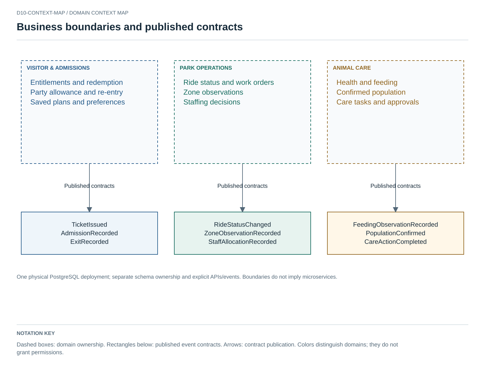

Visitor & Admissions owns entitlements and redemption; Park Operations owns status, work orders and zone observations; Animal Care owns feeding, health, population and care tasks. Edge, identity, reporting and AI are supporting capabilities. Cross-context changes use explicit contracts rather than direct writes into another module's tables. 

</details>

## 4. Business workflows

### 4.1 Tickets, family passes and admission

1. A visitor selects an approved product and party allowance. Payment follows the payment provider's workflow; an idempotent issuance reference prevents retries from creating extra entitlements.
2. The issuer creates a signed entitlement containing ticket ID, issuer/key ID, product/version, validity and party allowance. A maintained public-key signature implementation is used; Ed25519 is the starting choice subject to supplier/platform compatibility.
3. A gate validates the signature, validity, known revocations and product rules, then requests redemption from the local entrance authority. That authority atomically checks remaining party allowance and records the admission.
4. Admission changes occupancy; ticket sale does not. Exit observations and explicit re-entry policy support occupancy and pass use, with missing observations reflected in confidence.
5. When WAN returns, the estate reconciles admissions, exceptions, refunds and settlement. Offline revocation information can be stale; that residual risk is recorded.

<details>
<summary><strong>D04 — Admission sequence and recovery branch</strong></summary>

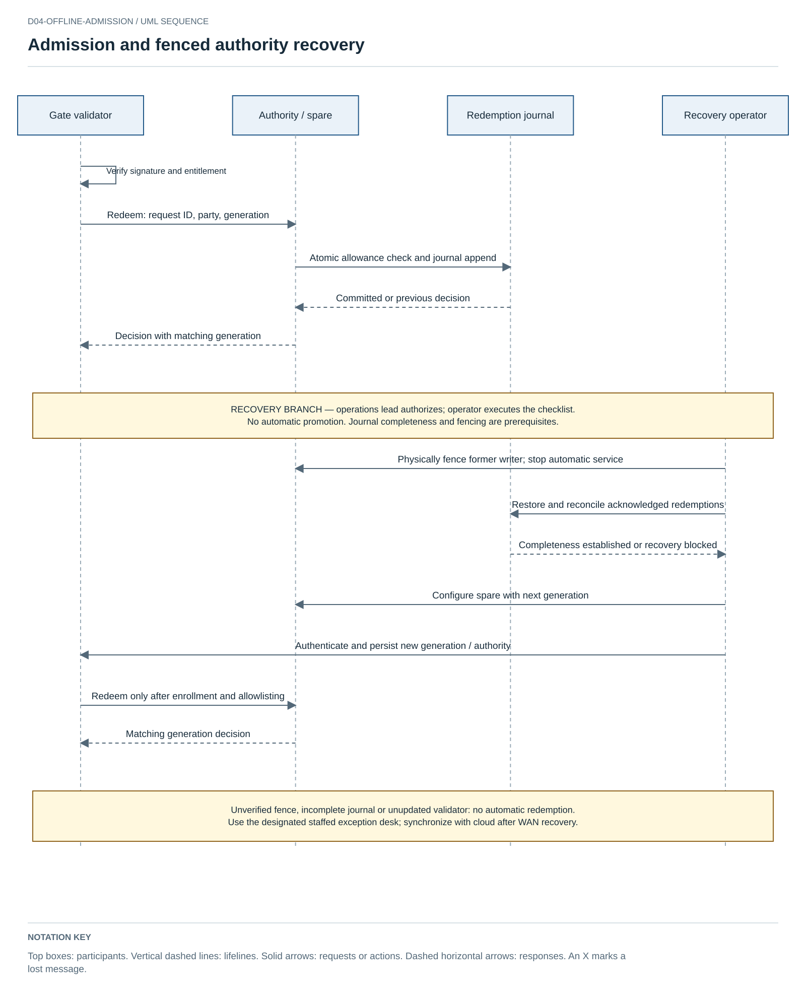

</details>

**The hard choice:** a signature proves authenticity, not that another gate has not used the same ticket. Fully disconnected validators cannot guarantee global single use. We provision one local authority and admission network; when a gate cannot reach it, automatic redemption stops and staff handle logged exceptions. This costs throughput and convenience. We prefer that visible tradeoff to silently admitting duplicate parties. Refund/revocation age, split parties and re-entry terms are implementation policies agreed with the ticket supplier and operations.

**Authority recovery:** the admission service and its durable journal use a protected local host and UPS. A warm spare supports recovery but never becomes an independent automatic writer. Operations first fences the failed primary, restores a verified journal and increments the authority generation before enabling redemption. Validators must reject responses from an obsolete generation. If the latest committed journal cannot be recovered, remain in staffed exception mode until outstanding redemptions are reconciled. This is a deliberate single-writer design, not an unimplemented claim of active-active availability.

#### Local authority and offline access contract

**Admission recovery policy:** no automatic promotion. The operations lead authorizes recovery and a platform/field operator executes a checklist. Stop automatic redemption, record the last known generation and committed sequence, and physically disconnect or disable the old host's power/network/switch port. Record the fence; inability to demonstrate isolation blocks promotion. Restore a journal that accounts for the latest acknowledged redemptions, including retained validator decision references. A backup whose completeness cannot be established does not qualify.

The recovery operator advances the generation monotonically using the protected generation register; every enabled validator must persist the new generation and authority identity through authenticated local enrollment. The new authority is configured with an explicit allowlist of those updated validators. An unupdated validator remains outside automatic service. Requests and responses carry the generation and request ID; mismatches are rejected. Physical fencing and selective re-enrollment establish exclusivity—the generation number alone cannot stop an isolated former writer. If state completeness or fencing is uncertain, use logged staffed exceptions until reconciliation. One designated, provisioned exception desk controls manual admissions; disconnected lanes do not each invent an independent exception authority.

| Trigger | Decision owner | Permitted operation | Condition for automatic recovery |
|---|---|---|---|
| WAN lost, local admission LAN intact | Operations lead | Existing local authority redeems; synchronize later | Restore authenticated cloud link and reconcile |
| Gate loses local authority connection | Entrance supervisor | Route visitors to reachable lanes or the designated exception desk | Gate reaches enrolled authority at matching generation |
| Primary host fails | Operations lead + recovery operator | Pause automated redemption; staffed exceptions | Fence old host, establish complete journal, advance generation, enroll validators |
| Journal incomplete or fence unverified | Operations lead | Exception desk only; preserve evidence | Reconcile outstanding decisions; do not guess remaining ticket allowances |
| Offline capture grant expires | Animal-care lead / shift supervisor | Paper/manual observations and independent emergency procedures | Current authority renews the grant or accepts attributed transcription |
| Offline draft arrives after staff revocation | Animal-care lead | Quarantine as unverified evidence; preserve original author/time | Qualified review reconciles it; no automatic care task or approval |

**Capture access:** issue device-bound, capture-only grants for at most 12 hours, renewed while connected; no offline renewal or grace period. Restart without trustworthy expiry enforcement fails closed for digital capture. Grants permit drafts only; no clinical approval or execution authorization. The 72-hour summary buffer does not imply 72 hours of authenticated staff access. After expiry, staff use manual records, later transcribed with occurrence time, transcription time, author and provenance. A stolen device may retain capture access until expiry; device locking and restricted scope limit the exposure. Reconnection revalidates actor, grant, evidence and occurrence time; uncertain drafts remain quarantined rather than silently erased.

**Care outcome contract:** task approval authorizes a specific action against a current version. At action start the software rechecks it and records an action attempt ID. Staff report completion, failure, or an unknown outcome separately. Repeated reports with the same attempt ID do not create another record. The software cannot make a human physical action idempotent. Never automatically repeat an action whose physical outcome is unknown; a qualified person reconciles it. Emergency action follows established local procedures and is recorded retrospectively with provenance where necessary.

### 4.2 Animal health, feeding and authorized care

[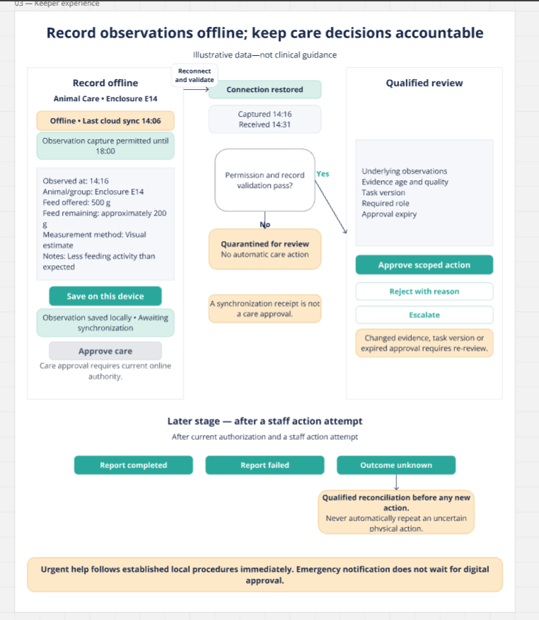](diagrams/rendered/v03-keeper-experience.png)


A keeper records subject or group, enclosure, time, measurement/behavior, feed and units, offered/remaining/estimated consumption, evidence and quality. Group feeding estimates are not silently treated as exact individual consumption. Missing readings remain missing. A manual rule or advisory model can create a review candidate; it cannot prescribe or execute treatment.

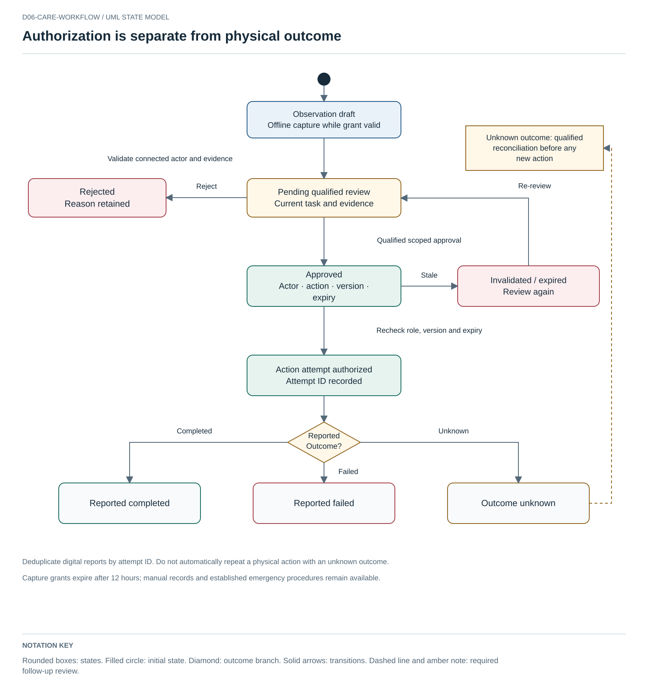

Approval binds **actor, required role, task ID/version, exact action, reason and expiry**. Execution rechecks those conditions; changed evidence invalidates the old approval. Approval and audit commit together, and actual completion/failure is recorded separately. Digital reports are deduplicated by action attempt ID. Staff record completed, failed or unknown outcomes; an unknown physical outcome requires reconciliation, never an automatic repeat. A digital approval is not proof that care occurred.

Urgent notification and escalation do not wait for treatment authorization. If a reviewer is unavailable, the care action remains pending while established emergency procedures continue. Clinical, feeding and containment thresholds are not invented by the architecture or the model. A staff kiosk served by the edge runtime can capture observation drafts on the provisioned local LAN. Offline access uses a cached, expiring capture-only role; it cannot approve care or issue an execution authorization. After reconnection, the cloud revalidates the actor and observation before creating a review task. Established local emergency procedures remain available independently.

[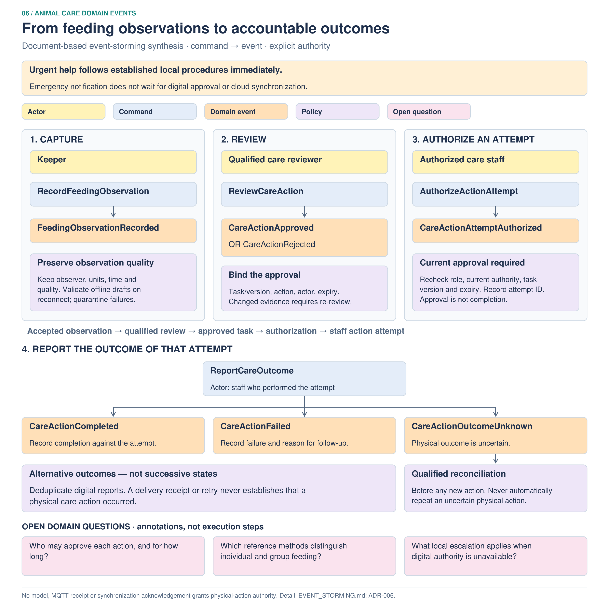](diagrams/rendered/v06-care-domain-events.png)

The three reported outcomes are alternatives. Only an unknown physical outcome enters the uncertainty-reconciliation path; a digital retry never repeats a physical action. [Domain synthesis](EVENT_STORMING.md).

### 4.3 Piranha population and feeding observations

The keeper-confirmed population ledger is the system of record. Its visitor-independent operations view shows the last independently confirmed total, confirmation date/method, recorded births/deaths/transfers and unresolved discrepancies. Where an independent reference is unavailable, it explicitly shows “total population unverified”; no camera estimate silently fills that field. Births, deaths, transfers and corrections update it through authorized reconciliation. Manual counts and model estimates are separate observations with method, time, coverage and uncertainty. Camera quality, reflections, turbidity, overlapping fish and changing visibility may make counting infeasible; a confident-looking number does not solve that problem.

The same separation applies to feeding: record what was offered and observed, and distinguish measured remaining feed from estimated intake. Model assistance can highlight unusual patterns or identify a candidate count for review. It cannot replace the record with an unreviewed estimate. Section 5 defines the model trial and stop conditions.

### 4.4 Popularity and returning visitors

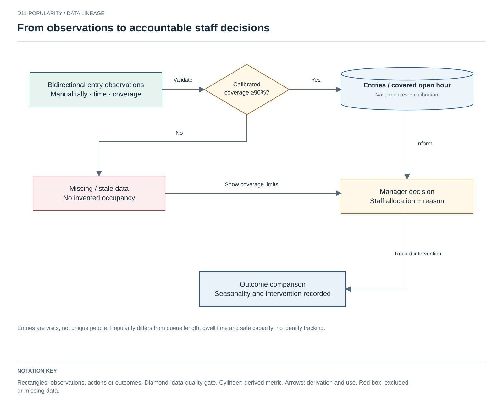

#### Visitor growth and return-visit journey

The commercial design addresses three distinct levers: attract a first visit, complete a suitable purchase, and make a return visit worthwhile. Visitor & Admissions owns the journey; it does not depend on identifying people through popularity sensors.

| Step | Selected behavior | Owner and measure |
|---|---|---|
| Discover | Publish accessible, shareable pages for approved attractions, seasonal events and pass products. Estate staff select campaign/referral links; no model invents events, prices or availability. | Visitor product owner: qualified landing sessions and attributed completed purchases, with attribution limits shown |
| Buy | Present clear party eligibility, published prices, accessible assistance and available timed-entry slots through the normal checkout. Abandoned checkout is distinct from failed payment. | Ticketing owner: completed purchases / initiated checkouts; supplier reconciliation; no card data in ATLAS chat |
| Visit | Help the visitor select appropriate activities from current authoritative information. Record admissions separately from sales. | Operations: actual attendance, exceptions and task completion |
| Save a reason to return | After a visit, offer an optional saved plan based on interests the visitor explicitly chooses and approved attractions/events. A visitor may save a plan without consenting to reminders. | Visitor product owner: voluntarily saved plans and declared interest categories |
| Re-engage | With a separate opt-in, send at most one requested reminder in a 30-day window through the ticketing supplier's existing notification capability, if available. Without that capability, retain the saved plan on the account page; no new messaging platform is assumed. Recheck permission and suppression immediately before sending. | Visitor product owner: delivery/opt-out/complaint rates, reminder-to-purchase conversion; stop reminders on withdrawal |
| Return and learn | Normal checkout and admission establish a subsequent visit. Compare repeat attendance and incremental contribution with a declared baseline/holdout. Renewing a pass, opening a message or saving a plan is not a return visit. | Operations/finance: 90-day observed return rate and contribution, accounting for support/offer costs |

A returning visitor can reopen the same bounded discovery assistant. It selects approved activity IDs using visitor-confirmed preferences; saving is a separate authenticated application command initiated by the visitor. A future plan is a saved interest, not a reservation, access guarantee or assertion of future opening. Revalidate date-specific status, access and capacity when the visitor books or arrives. A curated seasonal list is the non-AI baseline. There is no autonomous marketing agent, automatic discount or additional AI authority.

**Measurement contract:** propose a 90-day return window. The denominator is consenting, linkable adult account holders with a recorded initial admission and a complete 90-day follow-up window; the numerator is those with at least one later admission on a different date within that window. Report unlinked visits separately; a purchaser account or family party is not an individually identified child or every visitor. Do not generalize this cohort to the whole estate. Compare a randomized reminder offer against ordinary account access where feasible; record allocation, sample size, seasonality and uncertainty. A small pilot establishes instrumentation and usability, not a statistically powered retention uplift. Finance attributes contribution once and includes reminder, offer and support costs.

**Scope and data:** Visitor & Admissions owns `SavedReturnPlan`, declared interests and separate reminder preference/version/withdrawal. The notification adapter checks the latest preference and keeps a delivery/suppression audit. No facial recognition, device tracking or inferred animal-health interests are needed. Proposed expiry is 180 days of inactivity for saved plans, or earlier on deletion; retain only minimal suppression/audit information under the records policy. Public/model inputs exclude contact details and booking history. Saved plans and reporting fit the foundation backlog; automated reminders are conditional on supplier capability and are removed from scope if their cost cannot fit the service-license/support allocation.

The product owner reviews the 90-day cohorts after sufficient follow-up. Continue a reminder or discovery feature only with acceptable user feedback, no unresolved permission failures, and a finance-reviewed contribution case. Stop the experiment if it merely shifts already-planned visits or increases workload without benefit. The architecture supports the 15,000/day ambition; marketing effectiveness and physical estate demand remain business hypotheses.

#### Popularity measurement and a staffing decision

[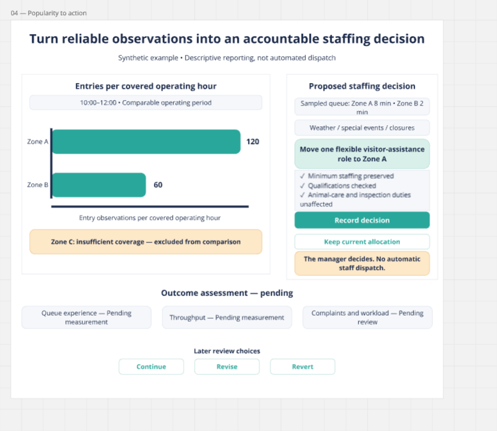](diagrams/rendered/v04-popularity-decision.png)


The pilot allocates **four bidirectional, non-identifying entrance counters within its existing 24-sensor allowance**, at four selected attraction entry boundaries. The other twenty sensors cover selected ride/environment observations. Counter hardware, adapters and calibration must fit the existing hardware/install allocation; replace unsuitable sites with scheduled manual tallying instead of adding an uncosted camera analytics fleet. Count every access point included in a reported boundary; an uncovered bypass makes that zone partial coverage. Staff take manual samples to detect groups, staff crossings, direction errors and resets. Open spaces without a controlled count boundary use sampled observation and are labelled separately.

**Selected metric:** popularity is visitor entry observations per **covered operating hour** for the same attraction and comparable time band. A covered hour requires usable counter data for at least 90% of the hour; show valid minutes, open minutes and excluded intervals beside the metric. Missing intervals are not zeros and are not extrapolated into precise totals. Repeat entries count as visits, not unique people. Queue wait, dwell time, occupancy and safe capacity remain separate measures. Raw count events contain zone/device/time/sequence/direction/quality, not a visitor identity.

At the start of each pilot shift, compare a 15-minute manual sample with counter entries, excluding separately annotated staff movements. A proposed pilot tolerance is absolute count error no greater than the larger of two entries or 10% of the manual tally; failed samples flag the interval and require investigation before ranking that zone. This is an unmeasured measurement-quality gate, not a sensor specification. Site layout and manual reference quality may require tighter or different limits before deployment.

For a **synthetic example**, Zone A records 240 entries over two covered operating hours and Zone B 120 over the same duration: 120 versus 60 entries/hour. A sampled queue of eight minutes at A and two at B may justify moving a flexible visitor-assistance role, provided minimum staffing and qualifications remain satisfied. High popularity does not itself justify reducing animal-care, inspection or physical-protection staffing. The manager records the reason, weather/event context and follow-up comparison of queue experience, throughput and complaints; counting an intervention is not evidence it worked. Historical popularity directs review and investment hypotheses, while live missingness/status governs how much confidence to place in the display.

<details>
<summary><strong>D13 — What the operator and visitor views must communicate</strong></summary>

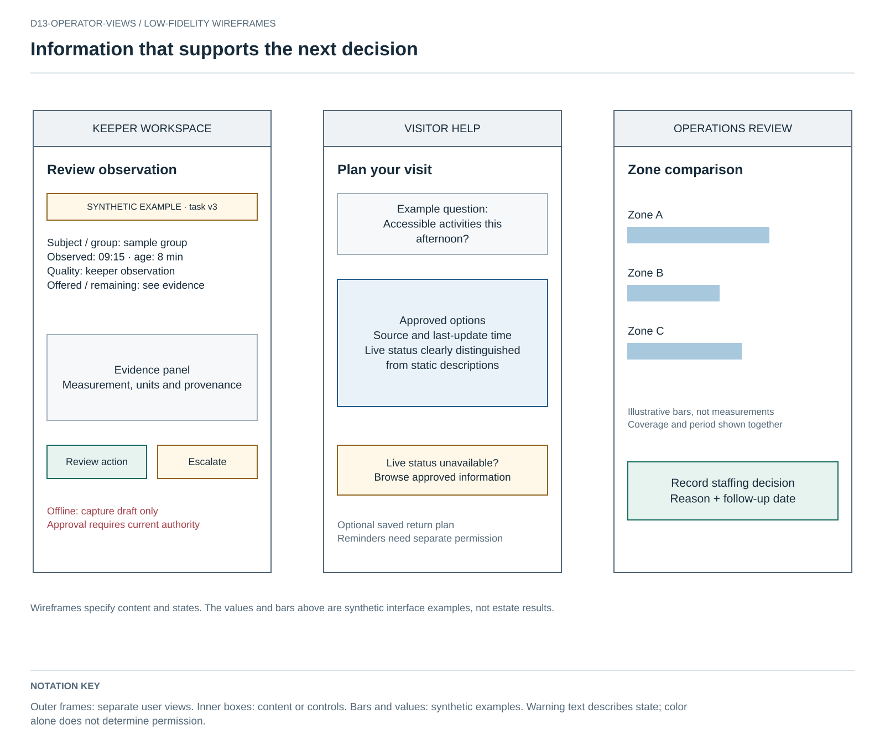

Keepers need evidence, age, quality and a clear approve/reject/escalate action. Visitors need sources, last update and valid options when live information is unavailable. Managers need trends, coverage and recorded decisions. This is an interface-content specification, not a screenshot of an implemented application.

</details>

## 5. AI design

The innovation is combining useful assistance with reliable observations and visible decision authority. We select AI by task and data readiness, rather than treating every estate problem as an LLM request.

| Use case | Baseline | Selected AI approach | Outcome and authority | Fallback |
|---|---|---|---|---|
| Visitor assistance | Approved FAQ/search and static accessible itineraries | Natural-language selection of approved activity IDs; confirmed constraints and fact templates | Explain and suggest validated options; no booking/price writes | Approved information/search and staff handoff |
| Animal health/feeding review | Keeper records, schedules and approved thresholds | Conditional statistical/anomaly ranking | Prioritize evidence for qualified review; no treatment authority | Manual observation and established care workflow |
| Piranha population | Keeper ledger and manual reconciliation | Conditional vision counting with capture-quality gate | Visible-count estimate plus coverage; independently confirmed total remains separate | Manual observation/reconciliation |
| Ride maintenance | Inspections and threshold trends | Conditional tabular ML; LightGBM is the initial candidate | Advisory inspection/work-order evidence; mechanic retains authority | Inspection/threshold baseline |

### 5.1 Grounded visitor assistant

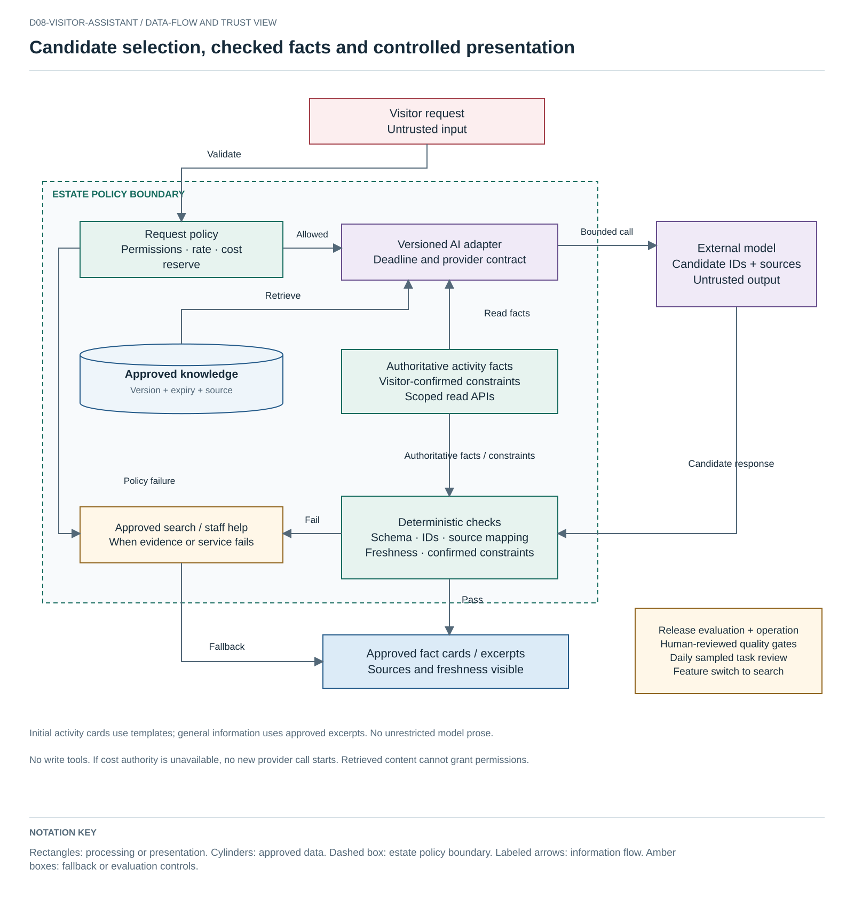

**Product decision:** trial natural-language discovery of approved activities as the first AI capability. The hypothesis is that visitors can find a suitable activity with less effort than browsing search results and applying filters themselves. The interface distinguishes “Find an activity” from “Estate information.” Only activity discovery enters the model candidate contract; general-information questions use approved full-text search and excerpts. Public release starts in English. Spanish, French, German and Hindi remain separately reviewed trial languages; unsupported languages receive published English information and staff help. No translation quality is assumed.

#### Retrieval and authority

Approved knowledge documents live in versioned object storage. A publishing job copies approved, unexpired text and structured facts into a PostgreSQL full-text index/read model, recording document ID, version, source URI, approver and expiry. Start with lexical retrieval over the small curated corpus; embeddings and a separate vector database are deferred until failed-query evaluation justifies them. Rank at most five eligible passages, with a bounded total input size. An empty or conflicting result uses search/help rather than an unconstrained answer. Retrieving approved content does not make embedded instructions trustworthy.

The estate application exposes read-only activity/status and approved-knowledge interfaces to the AI adapter. It also enforces a visitor-confirmed constraint object: access needs, available time and party restrictions. A model may propose an interpretation of natural language, but cannot silently relax these confirmed constraints. The initial activity product returns up to three independent options, not a claimed optimal multi-stop route. Route descriptions and individual visit durations come from approved records; route optimization is outside the pilot.

Use one hosted model through the versioned adapter, with no write tools, a five-second total deadline, a maximum 500 output tokens and no automatic retry in the initial visitor flow. Input, output and any billed reasoning allowances must have provider-enforced bounds compatible with the reservation contract; reject a provider configuration whose maximum charge cannot be bounded. Provider/model selection is an evaluation gate, not a claim that an untested model is interchangeable.

#### Fully specified example

[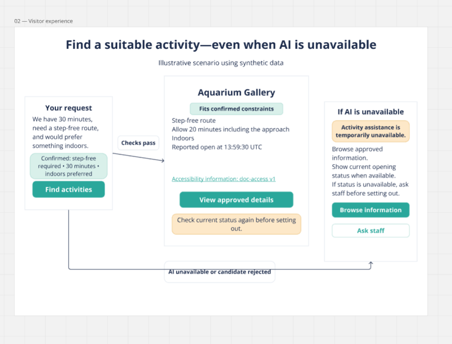](diagrams/rendered/v02-visitor-experience.png)


The following values are **synthetic fixture data**, not actual estate facts or an observed model response. Evaluation time is 2026-09-18 14:00 UTC. The visitor asks: “We have 30 minutes, need a step-free route, and would prefer something indoors.” The visitor confirms `wheelchair=true` and `max_minutes=30` in the interface.

| Evidence | Approved fixture | Implication |
|---|---|---|
| `doc-access`, version 1, expires 19 September | A1 Aquarium Gallery: step-free, 20 minutes including approach; A2 Conservatory: step-free, 25 minutes; R1 requires wheelchair transfer | A1 fits the confirmed access/time constraints; R1 does not |
| `doc-weather`, version 1 | A1 and A2 are indoor activities | Either matches the indoor preference if currently usable |
| Status API, observed 13:59:30 UTC | A1 open; A2 closed | A2 cannot be offered as open; the A1 observation is 30 seconds old |

A hand-authored candidate illustrating the model contract is:

```json
{"activity_ids":["A1"],"source_refs":[{"id":"doc-access","version":1},{"id":"doc-weather","version":1}]}
```

For activity recommendations, the model selects IDs and evidence references; it does not supply unrestricted final prose. The application checks the schema, approved source versions/expiry, activity membership, closure/status age and confirmed access/time/height constraints. It rejects the whole candidate on a failed check and shows approved search/help. For a valid candidate, the interface renders the option from authoritative structured fields:

> Aquarium Gallery — step-free route; allow 20 minutes including the approach. Reported open at 13:59:30 UTC. Accessibility information: doc-access v1. Check current status again before setting out.

The exact wording is an authored template. It is not a model-quality result. A candidate containing A2 is rejected because the current status is closed. A status older than 120 seconds, a future-dated status, an expired source, an unrelated citation, or an unknown activity cannot establish a current valid option. A fresh check occurs at display; a later closure can still occur and the UI does not promise continued availability.

#### What output checks establish

| Check | Mechanism | Limit |
|---|---|---|
| Shape and authority | Exact schema, ID allowlists, read-only service credentials, no write capability | Schema validity alone does not establish truth |
| Current operational facts | Join returned IDs to authoritative records; reject closed/stale/future/unknown status | Incorrect upstream observations can still mislead; field quality matters |
| Constraints | Apply visitor-confirmed access/time/height rules outside the model | The model must not be the sole interpreter of a consequential constraint |
| Source relationship | Require the current approved document version mapped to the displayed fact | A source existing is not proof that arbitrary prose follows from it |
| Explanatory language | Initial activity cards use templates; general information uses approved excerpts with source/expiry | Later free-form explanation needs separate human-supported semantic evaluation; no universal hallucination detector is claimed |

This narrows the model's role deliberately: natural-language discovery and candidate selection can add convenience while the presentation of consequential facts stays controlled. The [policy experiment](spikes/visitor-policy/README.md) exercises this boundary with hand-authored candidates. It does not measure whether an LLM selects the right IDs or whether users prefer the assistant.

#### Change, cost and failure

The knowledge owner previews changed content and its structured facts, publishes a version, and invalidates affected caches. Shared caches contain public information only and key on corpus/version/locale plus relevant status freshness. Public content is the only information sent to the model. Unknown or sensitive requests use an authenticated supplier workflow or staff handoff rather than placing private booking/care data into a prompt.

Reserve a maximum charge through a PostgreSQL budget row transaction keyed by UTC day and request ID. Admission requires settled usage plus outstanding reservations plus the new maximum to remain within USD 50/day. A duplicate request cannot reserve or call twice. Do not return an uncertain in-flight reservation to the spend pool after timeout; reconcile it with provider usage or conservatively charge its reserved maximum. A budget outage starts no new call. The policy spike does not implement this concurrent reservation protocol.

Compare the same tasks against full-text search and filters using the same documents and status data. Freeze the corpus, provider/model, prompt, constraints and scoring rubric for a run. The visitor product owner owns the decision; a reviewer checks high-consequence facts and translations. If the assistant fails the release contract, keep the useful search/records foundation and stop the assistant's incremental spend.

### 5.2 Animal anomaly and population assistance

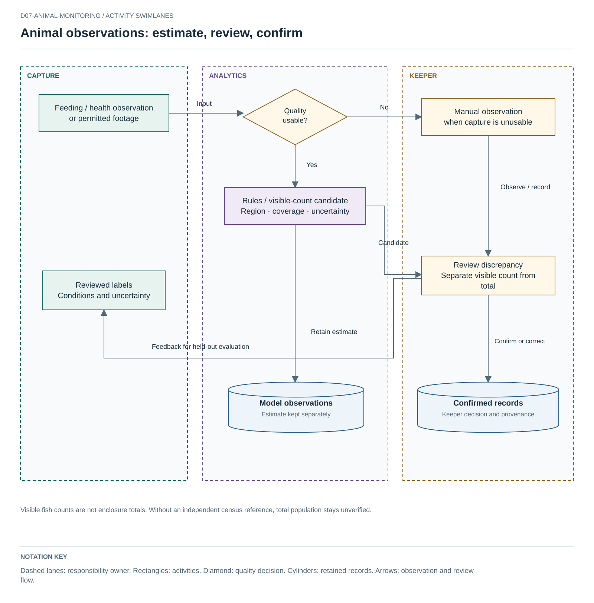

The animal-care lead owns labels and review policy. Use timestamped feeding/health/environment observations for anomaly trials and authorized representative footage for counting. Start with simple statistical/rule baselines. A more complex model must demonstrate useful additional signal and acceptable review burden.

For counting, evaluate absolute count error and systematic undercount across lighting, occlusion, reflections and turbidity, alongside abstention coverage and keeper review time. A frame-level detection score is not an estimate of total enclosure population accuracy. For anomalies, define the event/horizon and report precision, recall, false alerts per shift and workload. Separate seasonal or schedule changes from genuine anomalies. A confidence score without calibration or interpretation is not a decision policy.

If representative ground truth cannot be collected, or capture quality remains inadequate, do not deploy the model. Continue manual records and improve observation quality. That is an accepted outcome of the pilot, not a reason to invent an accuracy target after seeing the results.

#### Piranha measurement contract

The first camera experiment measures **visible fish in a defined observation region during a fixed sampling window**, then flags discrepancies for keeper review. It does not infer total enclosure population from an unconstrained frame count. Store visible count, capture region/coverage, timestamp, quality and uncertainty separately from the last keeper-confirmed population and its confirmation method/date. Never add counts across frames or cameras without an established identity/coverage method.

The animal-care lead defines an observation protocol compatible with existing welfare procedures. Two reviewers independently annotate a representative set of sample frames/windows; disagreements are adjudicated and ambiguous/occluded views marked non-observable rather than assigned invented exact labels. Agreement on visible fish supplies a reference for visible-count evaluation only. An enclosure total needs an independently justified, keeper-led census/reconciliation method; if unavailable, display “total population unverified” with the last confirmation date and continue discrepancy monitoring.

The pilot uses two camera positions to test whether useful coverage can be obtained. It compares manual visible-count review with a candidate detector/counting approach under the same observation protocol. Advance only if reviewers can establish a repeatable reference, the method's count error/undercount and abstention meet a tolerance recorded by the care lead before held-out review, and workload improves. If the reference or coverage fails, stop the camera trial; the structured feeding/health ledger remains useful. A signed ledger entry is evidence of an attributed confirmation, not proof that hidden fish were observed.

<details>
<summary><strong>Maintenance trial and model lifecycle</strong></summary>

### 5.3 Predictive maintenance

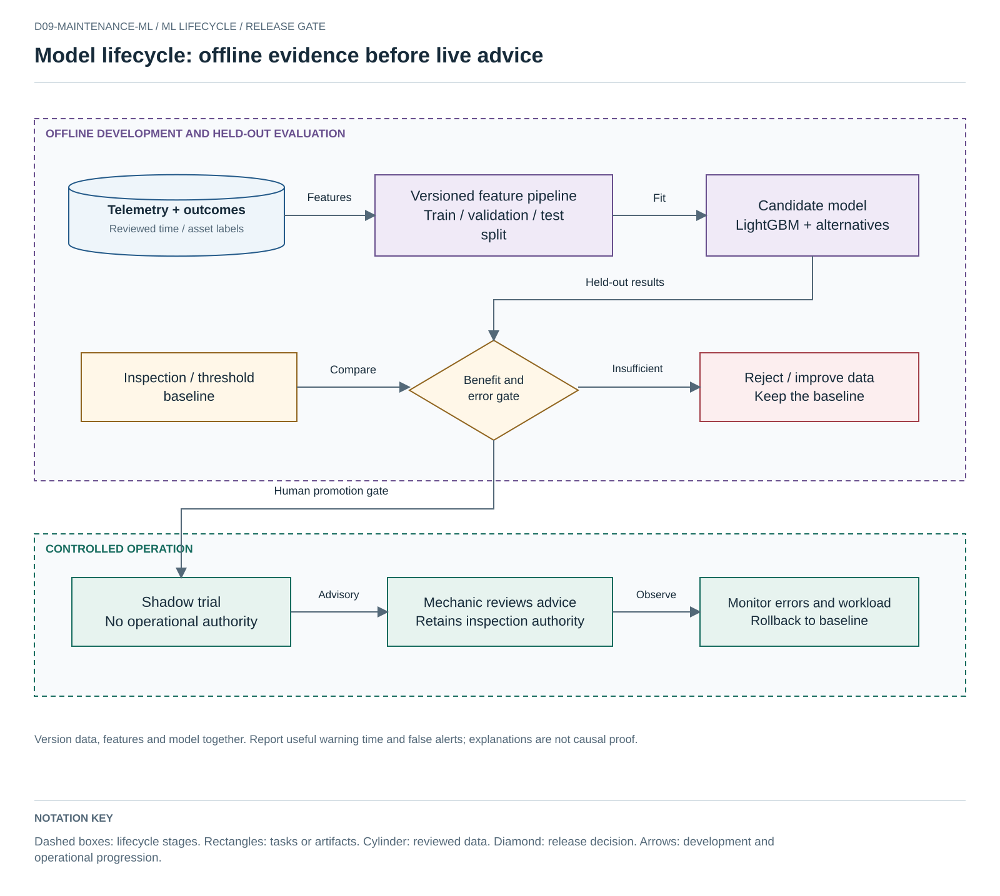

Maintenance is a supporting opportunity for estate operations, not a substitute for required inspections. Start with an asset inventory, calibrated sample windows, features such as RMS/spectral/thermal summaries, and consistent inspection/repair labels. Raw high-frequency acquisition is different from small MQTT summary events.

Compare the LightGBM candidate with inspection/threshold and simpler statistical baselines. Define the predicted event and useful warning horizon, split evaluation by time and asset to limit leakage, and report precision/recall, false alerts per ride/day, warning lead time and sample uncertainty. Test missing sensors and unknown assets. Shadow the model before using its advice in work-order triage. Model explanations describe associations; they do not establish causation. Mechanics retain inspection and return-to-service authority.

We accept the conditional architecture now and defer production model deployment until data and benefit support it. No recall percentage, causal diagnosis or inference-time guarantee is claimed from absent data.


</details>

### 5.4 Model lifecycle and authority

Version the schema, labels, feature pipeline, model, prompt, tool contract and approved corpus. Review held-out results and operating cost, deploy in shadow/canary mode, monitor drift and review workload, then promote or roll back. A provider or knowledge change can invalidate earlier evaluation. The fallback must be usable without a successful model response.

<details>
<summary><strong>D14 — Advice, action authorization and physical protection</strong></summary>

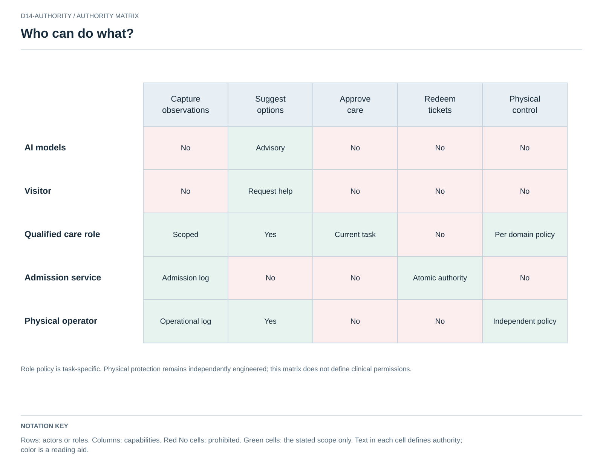

LLMs, CV and traditional ML all remain advisory. Deterministic permission checks stand outside models. Humans have task-specific authority; independent physical protection and emergency procedures retain theirs. A valid JSON response or repeatable model output is not permission to act.

</details>

### Production AI monitoring and response

The model/knowledge owner is accountable during estate opening hours; the operations lead can disable the AI feature. The first public pilot uses one reviewed model configuration, a small canary audience and a feature switch back to search. Model changes do not silently receive the previous model's approval. Read-only access and deterministic checks remain active during monitoring.

| Signal and proposed trigger | Detection and owner | Response |
|---|---|---|
| Any confirmed privacy, authority or consequential constraint violation in displayed output | Visitor reports, policy logs and daily reviewer sample; model/knowledge owner | Disable the affected AI path immediately; preserve minimal evidence; determine whether model, content or application policy caused it; evaluate before re-enabling |
| Invalid-candidate/fallback rate above 20% across the last 50 model requests, or more than twice the frozen evaluation baseline when that is at least 5% | Rolling request metrics; platform owner | Investigate retrieval, source expiry and provider changes; use search while errors persist. Low volumes receive manual review rather than a noisy rate alert |
| Plausible but unhelpful recommendations | Review ten randomly sampled accepted recommendations per operating day, or all if fewer; all reported failures; visitor product owner | Check intent, sources, confirmed constraints and task outcome; two major task failures in the daily sample pause the canary for investigation |
| Stale/withdrawn knowledge or revoked approval | Expiry checks and knowledge publishing audit; knowledge owner | Exclude affected content, invalidate its caches and restore approved information; a model rollback cannot fix incorrect source data |
| Repeated timeout, malformed response, 429 or 5xx | Five consecutive provider failures; platform owner | Open a proposed five-minute circuit, serve search, then try one controlled probe; provider calls still obey deadline and budget rules |
| Cost forecast exceeds allocation, published price changes, or usage cannot be reconciled | Daily usage reconciliation and price/configuration check; platform owner | Update the versioned reservation price before more calls; unknown maximum cost disables calls; reduce scope/call volume rather than silently raise the cap |
| Provider shutdown or unsupported API/model | Failed contract check or provider notice; platform owner | Continue search; revoke unused credentials and promote a replacement only after the full evaluation contract; automatic unevaluated substitution is prohibited |
| Animal/maintenance model outside reviewed conditions, rising false alerts or growing review backlog | Reviewed outcomes, coverage and per-shift workload; relevant domain lead | Suspend advisory model, preserve qualified manual/threshold workflow; recalibrate/review data before shadow promotion |

These are proposed operational triggers, not achieved service levels. Validate their workload and sensitivity in the pilot. Correlate model/prompt/corpus/policy versions with outcomes. Store only the approved diagnostic fields needed for the seven-day review window; redact personal/free-text content and keep any incident evidence under the separate records policy. Deterministic rejection rates detect one class of failure; human review and task outcomes catch confidently irrelevant but structurally valid selections. Animal and maintenance limits are fixed by the responsible domain owner before held-out evaluation, not selected after seeing favourable results.

Weekly, the model/knowledge owner reviews sampled failures, fallback rate, task outcomes, latency and cost with operations. A correction becomes a regression case and reruns the affected evaluation plus critical policy cases. A severe incident does not wait for that meeting. During cloud/model failure, established care and admission procedures remain authoritative; no incident process grants the model new powers.

## 6. Decisions and alternatives

The decisions below define the selected architecture. Deployment gates identify what must be demonstrated before a capability is released.

| ADR | Selected decision and why | Alternative rejected or deferred | Tradeoff we accept |
|---|---|---|---|
| [001](adrs/adr-001-mqtt-vs-wifi-edge-strategy.md) | MQTT on provisioned local IP links; authenticated batch backhaul | MQTT as a substitute for missing coverage | Survey, adapters and local network operation remain necessary |
| [002](adrs/adr-002-store-and-forward-edge-storage.md) | SQLite WAL/FULL outbox; final destination receipt and durable inbox/effect transaction | Memory-only buffer; cache/Bloom filter as final duplicate authority | Media/write cost, finite capacity and explicit hardware-failure limits |
| [003](adrs/adr-003-exclusion-of-genai-from-pricing-and-safety.md) | Separate AI advice from pricing, admission, care execution and protection | Autonomous model write tools and initial RL prices | Less automation; greater clarity of responsibility |
| [004](adrs/adr-004-vendor-agnostic-ai-gateway.md) | Thin versioned adapter, one evaluated provider, spend/deadline controls | Provider SDKs everywhere; immediate proxy fleet or local LLM fallback | Adapter maintenance and re-evaluation when providers change |
| [005](adrs/adr-005-predictive-maintenance-traditional-ml.md) | Baseline first, conditional tabular ML and shadow evaluation | Predictive deployment without usable labels | Benefits may arrive later or the model may not be deployed |
| [006](adrs/adr-006-human-in-the-loop-animal-care.md) | Versioned, action-specific human approval; independent escalation | Automatic intervention; passive dashboard without workflow | Review staffing and human error remain operational risks |
| [007](adrs/adr-007-system-boundaries-and-build-buy.md) | Modular core, explicit runtime boundaries, bought commodity capabilities | Many microservices and a large streaming/ML stack initially | Some shared scaling/deployment until extraction is justified |
| [008](adrs/adr-008-offline-ticketing-and-reconciliation.md) | Signed entitlements plus one local redemption authority | Independent isolated gates claiming global single use | Staff exceptions and reduced throughput during local partitions |
| [009](adrs/adr-009-operational-data-and-event-contracts.md) | Module-owned relational state, transactional events, derived analytics | Shared uncontrolled writes or analytics as operational authority | Contract/version discipline and possible reporting lag |
| [010](adrs/adr-010-grounded-assistant-and-evaluation.md) | Approved grounding, freshness-aware reads and evaluated outputs | Ungrounded chatbot or unconstrained operational agent | Smaller answer scope; refusal/fallback when evidence is inadequate |
| [011](adrs/adr-011-population-and-feeding-monitoring.md) | Keeper-confirmed records; separate model estimates and quality checks | Treating camera counts as unquestioned truth | Manual effort and a model feasibility gate |

**Choices deliberately left to implementation:** cloud region/provider, a ticket supplier meeting the contract, evaluated model/provider version, site-specific sensor placement, domain thresholds and precise retention obligations. We define the selection conditions now rather than fabricate procurement, geography or clinical facts. These choices do not prevent reviewers from understanding what runs where, who owns state and how failures are handled.

## 7. Data and consistency

| Entity | Owner | Essential information |
|---|---|---|
| Entitlement / Redemption | Visitor & Admissions | Ticket/product/key/validity/party allowance; admission authority, local sequence, decision and exception reason |
| AnimalOrGroup | Animal Care | Subject/group, species reference, enclosure, confirmed population and provenance |
| FeedingObservation | Animal Care | Offered/remaining/estimated consumption, units, time, keeper and quality |
| HealthObservation / PopulationObservation | Animal Care | Measurement or estimate, method, evidence, occurrence/receipt time, quality and reviewer |
| CareTask | Animal Care | Evidence version, requested action, role, state, expiry, approval and actual outcome |
| RideStatus / WorkOrder | Park Operations | Asset, state, inspection authority, evidence and maintenance outcome |
| ZoneObservation | Park Operations | Zone, method, metric, time window, coverage and freshness |
| AuditEntry | Owning module | Actor/device/service, command, reason, version, timestamps, outcome and correlation |

A canonical event carries `event_id`, `event_type`, `schema_version`, `source_id`, `aggregate_id`, source epoch/sequence, occurrence and receipt times, priority, correlation and a bounded payload. Persist identity before first delivery; retries reuse the same identity and content. Clock time is not a uniqueness mechanism. Object references carry large evidence outside the summary event.

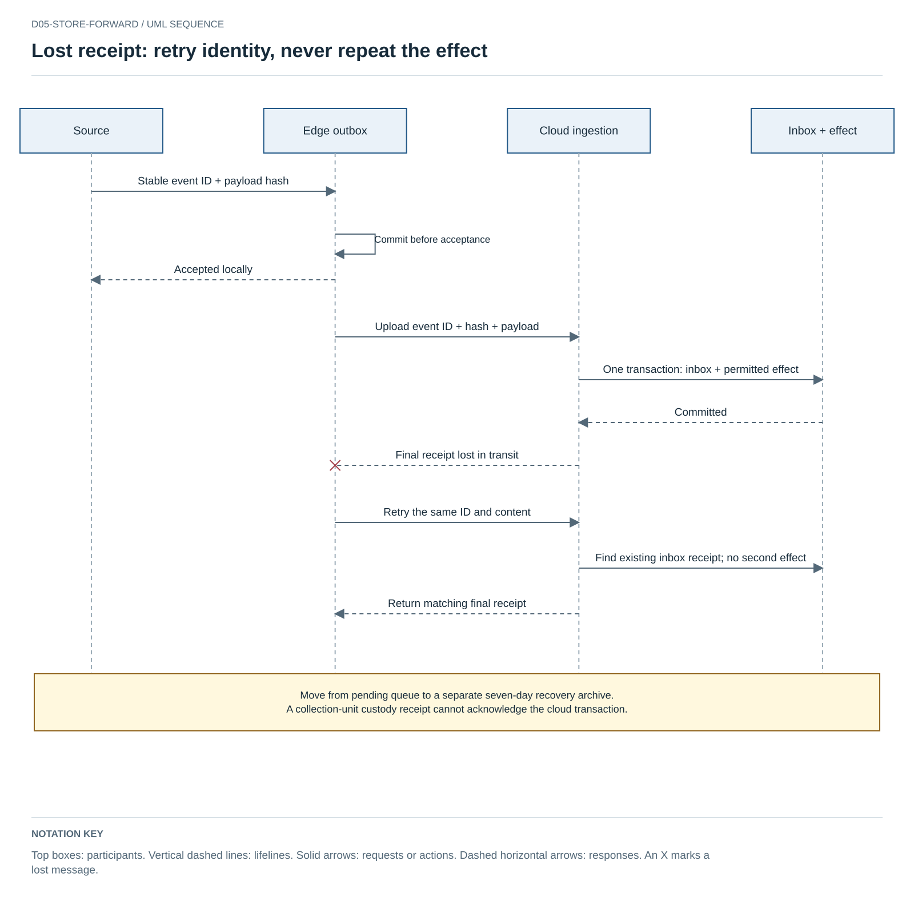

1. Validate payload, capacity and source; commit locally before application-level acceptance.
2. Upload stable IDs and content hashes over an authenticated channel. MQTT/broker acknowledgement is not destination business completion.
3. Destination validates source permission and schema; record inbox identity/hash and the permitted business effect in one transaction.
4. Same ID/content returns the previous receipt without another effect. Different content under the same identity is a conflict, quarantined with visibility.
5. Only a matching **final destination-commit receipt** permits removal from the local pending queue. Lost receipt means retry, not inventing a new event ID. A valid receipt moves the observation from the pending queue into a bounded seven-day recovery archive; it does not immediately erase the only recoverable edge copy.
6. A collection-unit receipt proves custody only. Retain the source copy until final receipt unless a separately reviewed replicated-custody design replaces that rule.

Priority may reorder unrelated records; per-aggregate sequence/epoch and gap handling preserve relevant order. Invalid or unsupported versions do not silently disappear. Additive optional fields can remain compatible; breaking semantics need a new version and a migration window. Telemetry deduplication does not by itself prevent duplicate payments, clinical actions or other external effects; those commands have their own idempotency contracts.

Cloud disaster recovery is separate from ordinary delivery. Retain acknowledged observation events for seven days at the edge and replay the required interval after a restore, reusing original IDs; the restored destination deduplicates those it already contains. Expiry and pending quotas are separate, and sensitive data follows its retention policy. This reduces exposure for recoverable observations but does not restore lost cloud-only transactions or destroyed gateways. Managed point-in-time recovery and financial/care reconciliation remain necessary. The replay spike tests the receipt/deduplication mechanism; the recovery archive and real restore procedure are design requirements, not implemented test claims.

## 8. Failure and security

### 8.1 What happens when something fails

| Failure | What remains useful | Limitation and recovery |
|---|---|---|
| WAN unavailable; local power/LAN healthy | Local redemption, capture-only observation drafts, bounded telemetry buffer | Cloud views stale; no implicit payment authorization; replay/reconcile afterward |
| Sensor-to-gateway link lost | Other sources and manual observations | Unacquired readings cannot be reconstructed as measurements |
| Staff Wi-Fi lost | Explicitly provisioned wired/local terminals and manual process | A locally hosted dashboard is not automatically reachable |
| Gateway power/storage destroyed | Independent protection and manual procedures | Unsent sole-copy data may be lost; replace/re-enroll and record the gap |
| Cloud app/ingestion unavailable | Bounded local operation | Monitor backlog locally; restore, verify receipts and pace replay with fresh traffic |
| Storage reaches hard limit | Previously retained records and visible local alarm | Reject further acceptance explicitly; predefined low-priority aggregation/drop must be counted |
| Collection route fails | Headroom and routine local checks | A disconnected gateway cannot rely on sending a remote alert |
| Model/provider/budget unavailable | Approved information, manual/threshold baseline and human help | Reduced functionality; bounded retries and controlled rollback |
| Care reviewer unavailable | Observation capture, notification and escalation | Treatment authority remains pending; existing emergency response continues |
| Admission authority unreachable | Staffed exception process | No claim of unique automatic redemption across isolated gates |

Recovery identifies the failed boundary, assigns an owner, communicates stale/unavailable state, restores verified configuration, checks record/receipt counts, replays idempotently, reconciles exceptions and records data gaps. Backup success alone is not proof of usable restore. Exercise real local network, power, disk and WAN failures separately.

### 8.2 Trust and access

Use authenticated device channels, declared source/topic ACLs, protected local data, managed secrets, least privilege and auditable transitions. Protect issuer private keys; validators hold public keys and enforce expiry, rotation and the accepted revocation-staleness policy. Do not implement custom cryptography. Guest connectivity must not confer staff, admission or device permissions.

| Threat | Control and remaining exposure |
|---|---|
| Copied QR / stale revocation | Atomic local redemption, isolation policy and reconciliation; unseen offline revocations remain possible |
| Stolen staff device / stale approval | Protected device, expiring role, task/action/version binding and execution recheck; offline revocation affects availability |
| Spoofed sensor / forged batch | Device identity, source authorization, schema/hash checks; compromised authorized hardware still needs detection |
| Prompt injection / cross-visitor leakage | Treat retrieved text as data; scoped read tools, external permission checks and isolated personal context; prompt filtering alone is insufficient |
| AI cost abuse | Rate limits, atomic reservations, output/deadline/retry limits; fail closed when budget state is unknown |
| Lost collection unit | Encryption, authenticated enrollment, manifests and custody; source retained until final receipt |
| Poisoned labels / drift | Reviewed provenance, held-out evaluation, monitored workload and versioned rollback |

### 8.3 Operating ownership

Estate operations owns training, manual processes and incidents. Platform support owns restore, capacity and cloud availability. Field support owns power, links, calibration, backlog and spares. Animal-care and maintenance leads own review quality and domain procedures. The model/knowledge owner owns source freshness, evaluations, cost and rollback. The privacy/records owner establishes jurisdiction, purpose, retention and access/deletion policy.

Devices are inventoried, provisioned, calibrated, monitored, updated in stages with rollback, rotated and ultimately revoked/sanitized. Support staffing is a cost assumption, not an invisible free service. Avoid unnecessary visitor identity tracking; prefer aggregate popularity. No legal compliance, physical safety certification or domain sign-off is claimed from these software diagrams.

## 9. Validation and evidence

The evaluation separates demonstrated software behavior from release conditions for models and field deployment. A bounded reliability experiment tests event acceptance, retry and atomic deduplication; representative field and model evaluations govern later promotion.

### 9.1 Executed reliability experiment

A bounded Python/SQLite experiment models local acceptance, final receipts, destination deduplication and atomic effects. **All 12 focused tests passed in the recorded local run.**

| Tested behavior | Observed result |
|---|---|
| Process abruptly exits after local commit | Accepted record available after reopening |
| Destination fails between inbox insert and effect | Both changes roll back |
| Final receipt lost and delivery retried | Existing receipt returned; effect not duplicated |
| Same identity carries different content | Rejected at edge and destination |
| Carrier-only or wrong-hash receipt arrives | Source pending record retained |
| Priority and limited batch | Declared priority/insertion order; unprocessed records remain pending |
| Quota full or payload oversized | No false acceptance |
| Destination reopened or receipt repeated | Deduplication state persists; receipt handling idempotent |

The demonstration accepts **20 events**, loses **2 final receipts**, leaves **2 pending source records**, then retries to reach **20 inbox records, 20 effects and 0 pending records**. These are actual synthetic-software results. [Test output](validation/results/unit-tests.txt) · [Demo output](validation/results/replay-demo.json) · [Runtime and source hashes](validation/results/run-record.json)

The experiment has no real MQTT client, WAN, cloud service, authentication, ticket provider or care application. Its process-exit test is not a physical power-cut test, and its logical quota is not a full-filesystem simulation. It does not prove estate-scale throughput or hardware durability. Those distinctions are part of the evidence, not hidden exceptions.

### 9.2 Visitor policy experiment and model evaluation

**Eighteen focused deterministic policy tests pass in the recorded local run.** They exercise accepted candidates, closed/unknown activities, stale/future status, source expiry/version/relationship, access/time/height constraints, extra candidate fields and unavailable budget/provider state. Facts are rendered from authoritative fixture data. [Code and scope](spikes/visitor-policy/README.md) · [Actual output](validation/results/visitor-policy-tests.txt)

These tests use hand-authored model-shaped responses; no LLM is called. The document-injection case establishes only that this function does not treat prose as permission. It does not establish prompt-injection resistance of an integrated model application, semantic quality, field accuracy or visitor benefit.

The [48 visitor cases](validation/datasets/visitor-scenario-specifications.json) reference [concrete approved-source fixtures](validation/datasets/visitor-fixture.json), exact timestamps/overrides, required facts, source IDs and explicit oracles: 12 ordinary, eight unanswerable, eight stale/closed, eight adversarial/privacy, six multilingual and six accessibility/party cases. All model results remain unset. The proposed model/user evaluations are separate from executed policy checks.

### Release decisions and proposed acceptance rules

These are selected **pilot decision rules**, not measured performance or domain certification. Owners may tighten them before evaluation, recording the reason; they must not relax them after seeing failures merely to pass a candidate.

| Gate | Accountable role | Measure and proposed acceptance rule | Failure decision |
|---|---|---|---|
| G1 Foundation continuity | Operations lead + platform owner | Account for every accepted ID in outage/replay and restore exercises; duplicate delivery creates no second digital effect; incomplete admission recovery stays in exception mode; capture expiry routes to usable manual records | Fix foundation before adding operational scope |
| G2 Assistant policy and quality | Visitor product owner + independent knowledge reviewer | Freeze 48 cases and materialized fixtures; run each three times per candidate configuration. No high-consequence constraint, privacy or authority violation; at least 90% task-pass rate overall and report each category separately | Retain search; correct failures and evaluate a fresh held-out set |
| G3 Assistant usefulness | Visitor product owner | Eight representative adult participants, six counterbalanced activity-discovery tasks each, using assistant and search on matched task variants with identical information. At least 90% task completion; no lower completion than search; median successful-task time at least 20% lower than search. Record mistakes, confidence and accessibility feedback | Stop incremental assistant release if it offers no useful improvement |
| G4 Assistant resources | Platform/model owner | T03 p95 under four seconds, five-second end-to-end deadline; provider maximum charge can be reserved; measured average daily spend fits the planned allowance and USD 50/day ceiling under the declared workload | Reduce usage/scope or keep search; do not bypass the cap |
| G5 Additional language | Knowledge owner + fluent reviewer | Repeat relevant tasks with the candidate locale; preserve facts, restrictions and meaningful handoff; no critical mistranslation on the reviewed set | Keep that language disabled; English/help fallback remains |
| G6 Animal observation feasibility | Animal-care lead | Two-reviewer visible-count reference can be established; pre-record count/undercount tolerance, coverage and review-time limit before held-out scoring; no claim of enclosure total without independent reference | Stop camera/model trial independently; retain structured records |
| G7 Maintenance readiness | Maintenance lead | Defined event and useful warning horizon, reviewed time/asset-separated labels, pre-recorded false-alert/lead-time limits and benefit against inspection/threshold baseline | Continue inspections and data collection; no predictive deployment |
| G8 Admission demand | Entrance operations lead | Under validated timed-entry arrivals, p95 queue wait below ten minutes, no overflow of domain-approved queue space, sustainable accessible-lane/staff provision | Reduce slot allocation and remediate passage/queue design |
| G9 Expansion investment | Finance + operations | Replace illustrative supplier/support assumptions; fund only capabilities with justified incremental contribution or explicitly accepted nonfinancial value | Stop or narrow expansion; do not assume the full envelope is approved |

G2's 48 cases are a small development/release contract, not a statistically representative population sample. Three repetitions expose some variability but do not establish a failure-rate bound. G3 is a directional usability pilot, not a statistically powered causal study. Counterbalance order and task variants; do not show the same answer twice and count recall as product benefit. A participant may stop a task; count failure/abandonment in completion, rather than excluding it to improve results. The time measure uses successful matched pairs, with excluded pairs and task-completion rates reported alongside it.

### Case execution and scoring

Each case references `visitor-fixture.json`, a frozen evaluation time, exact per-case overrides and an oracle containing required facts, source IDs, forbidden claims and the expected decision class. Materialize dot-path overrides before execution; document arrays are addressed by document ID. The fixture checker resolves every reference/override and checks that no model result has been populated. Multilingual cases contain separate public-fallback and trial-locale expectations. Synthetic fixtures are not field ground truth.

For each model run, record case ID, fixture hash, provider/model and prompt version, retrieved IDs/versions, confirmed constraints, candidate, final rendered output, latency, billed/reserved cost and the reviewer decision. Task pass requires the expected decision class, all applicable required facts, no forbidden claims and correct sources. Score source support, constraint respect and appropriate abstention separately; no single model-judge score substitutes for this rubric. Evaluate retrieval selection and language interpretation separately from the deterministic output checks. A fluent reviewer evaluates enabled translations.

Freeze a held-out set before prompt tuning. The included 48 cases are an initial public contract; create additional held-out variants for release so optimizing to published cases cannot masquerade as generalization. Any high-consequence failure blocks promotion even when aggregate task completion passes. Investigate, add a regression, and repeat affected plus critical cases after changes. Source/corpus changes rerun retrieval and grounding checks; schema/tool/provider changes rerun the full relevant contract.

### 9.3 Verification coverage

| ID | Verification scope | Status in this submission |
|---|---|---|
| V01 | Outbox, lost receipt, duplicate/conflict, rollback, priority and bounded acceptance | Narrow local experiment implemented and executed; hardware/network validation specified |
| V02 | Ticket signatures, keys, party/re-entry rules, concurrent redemption and partitions | Specified; ticket integration not implemented |
| V03 | Care roles, expiry, stale task version, replay/concurrent approval and outcomes | Specified; integrated workflow/domain exercise required |
| V04 | Concurrent AI spend, deadlines, provider errors and budget-store failure | Specified; no live-provider integration measured |
| V05 | Visitor assistant against FAQ/search and adversarial/unknown/stale cases | Evaluation designed; 48 synthetic scenarios specified; no model-quality score claimed |
| V06 | Animal/counting and maintenance model validation | Specified; representative datasets not yet established |
| V07 | Popularity against manual samples and manager use | Specified; field counts required |
| V08 | Capacity, restore, costs and business outcomes | Arithmetic executed; load/restore/outcome measurements pending deployment |

The verification plan connects these scenarios to acceptance conditions and retained evidence. [Evaluation details](validation/evaluation-plan.md)

## 10. Capacity and cost

### 10.1 Capacity exposes physical limits

| Assumed workload | Calculated result | Implication |
|---|---|---|
| 350 sensors, one 500-byte event every 10 s | 35 events/s | Modest average ingestion; test concurrent fresh traffic and replay |
| Above rate for 72 hours | 4.536 GB estate-wide | Even split across 25 gateways: 181.44 MB each, or 362.88 MB with 2× headroom; size the worst actual gateway separately |
| 15,000 visits × 20 API calls / 10 hours | 8.33 requests/s average; 83.33 at 10× burst | Endpoint mix, contention and supplier limits still need load tests |
| 15,000 arrivals in one hour | 4.167 people/s | Twelve lanes at five seconds/person provide only 2.4 people/s: selected policy below spreads admissions through capped timed-entry slots |
| 40 raw vibration sensors × 3 axes × 2 bytes × 1 kHz | 20.736 GB/day | Compute validated local features; retain bounded raw diagnostic windows |

The buffer arithmetic excludes video, database indexes/WAL, filesystem reserve and retransmission overhead. The 1 KiB maximum is not the assumed average. Set per-gateway capacity from measured encoding and assigned sensors, reserve OS space, alarm early and define explicit overload behavior. The camera count is a survey assumption, not an instruction to upload continuous footage. Software cannot create safe physical ride or enclosure capacity.

The recovery archive adds seven days of acknowledged summary retention: 10.584 GB estate-wide, plus the 4.536 GB pending-outage envelope. Provisioning both concurrently with 2× headroom gives **1,209.6 MB per average gateway** across 25 gateways, before indexes, WAL, OS reserve and skew. Pending data must not be evicted to preserve expired archive data.

### 10.2 Full illustrative cost envelope

All amounts below are **EUR planning assumptions**, not supplier quotes. The base includes delivery and support rather than presenting hardware as the entire project.

| One-off item | Basis | EUR |
|---|---|---:|
| Hardware, networking and spares | Provisional envelope | 34,750 |
| Software delivery | 180 person-days × 650 | 117,000 |
| Installation | 30 person-days × 450 | 13,500 |
| Training | 12 person-days × 450 | 5,400 |
| Data preparation | 30 person-days × 350 | 10,500 |
| Specialist review | 10 person-days × 800 | 8,000 |
| Subtotal | | 189,150 |
| Contingency | 20% of one-off subtotal | 37,830 |
| **One-off total** | | **226,980** |

| Monthly item | EUR |
|---|---:|
| Application, database and backups | 1,200 |
| Event ingestion/storage | 450 |
| AI usage allowance | 650 |
| Cellular backhaul | 350 |
| Support/operations allocation | 4,500 |
| Replacement reserve | 300 |
| Service licenses | 250 |
| **Monthly total** | **7,700** |

The all-months-at-full-capacity sensitivity case is **EUR 504,180**. Uniform 0.8× / 1.4× sensitivity yields **EUR 403,344 / 705,852**; these are stress cases, not statistical confidence intervals. Tax, financing, existing estate costs and physical ride/enclosure construction are excluded. The calculation conservatively applies full monthly run cost across all 36 months; the selected staged planning case is shown below and must be refined after the pilot.

The EUR 650 monthly AI allowance is expected allocation, while USD 50/day is a hard ceiling. At the illustrative—not live—conversion of USD 1 = EUR 0.90, exhausting the ceiling for 30 days would cost EUR 1,350. Forecast alerts therefore track the allocation as well as the hard cap.

### 10.3 Staged investment and independent stop decisions

[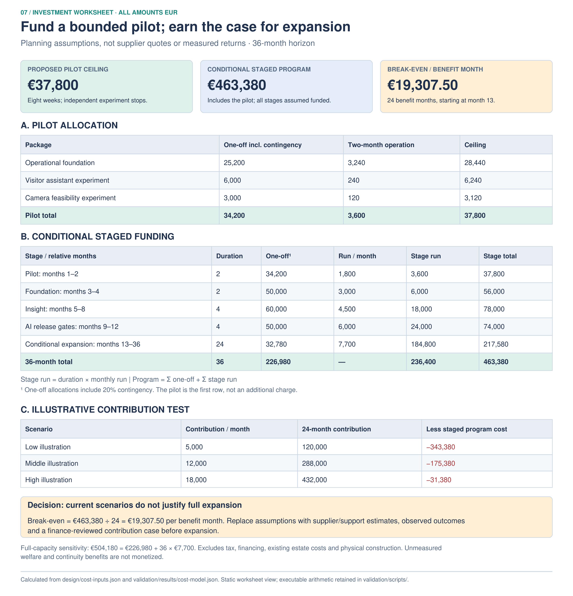](diagrams/rendered/v07-investment-scorecard.png)


The immediate proposal is an **eight-week pilot capped at EUR 37,800**, allocated within the overall program. All amounts are planning estimates, not supplier quotes or approved spending. The pilot includes discovery, one admission domain, four active gateways plus one spare, 24 sensors, capture-only care drafts, a visitor-assistant sandbox and two experimental camera positions.

| Pilot package | One-off including 20% contingency | Two-month operation | Ceiling | What remains if stopped |
|---|---:|---:|---:|---|
| Operational foundation | 25,200 | 3,240 | **28,440** | Local admissions, structured observations, replay and search remain the primary deliverable |
| Visitor assistant experiment | 6,000 | 240 | **6,240** | Approved search, filters and static information remain available |
| Camera feasibility experiment | 3,000 | 120 | **3,120** | Keeper records and manual observation remain available |
| **Pilot total** | **34,200** | **3,600** | **37,800** | Stop either experiment independently |

The foundation allocation comprises EUR 4,750 hardware/networking, 18 delivery days, four installation days, two training days, three data-preparation days and one specialist day. The assistant uses six delivery days, two data days and half a specialist day. The camera trial uses EUR 1,000 hardware, one delivery day, one installation day and half a specialist day. These reconcile to the original 25/5/2/5/2 pilot person-day totals. Shared delivery tools and existing staff availability are assumptions; if supplier integration cannot fit, narrow the pilot before approval rather than silently increase scope.

| Stage | Months | One-off allocation | Monthly operating estimate | Release condition |
|---|---:|---:|---:|---|
| Pilot | 1–2 | 34,200 | 1,800 | Fund only the bounded scope above |
| Foundation | 3–4 | 50,000 | 3,000 | Useful local admission and records; recovery and workload acceptable |
| Insight | 5–8 | 60,000 | 4,500 | Measurable capture quality and manager use; replace installation assumptions with estimates |
| AI release gates | 9–12 | 50,000 | 6,000 | Promote useful evaluated capabilities; exclude failed experiments from subsequent scope |
| Conditional expansion | 13–36 | 32,780 | 7,700 | Finance-reviewed contribution case and sustainable staffing/support |

The one-off allocations sum to EUR 226,980 and include the pilot; do not add it again. Staged operation totals EUR 236,400, producing **EUR 463,380 over 36 months** if every stage is funded. The all-months-at-full-capacity calculation provides a conservative sensitivity case: **EUR 504,180**, EUR 40,800 above the staged case. Neither is an unconditional commitment or a confidence interval.

Under the explicitly assumed month-13 benefit start, 24 months of contribution at EUR 5,000 / 12,000 / 18,000 yields EUR 120,000 / 288,000 / 432,000. Against staged costs, net differences are **−343,380 / −175,380 / −31,380**. Staged break-even requires approximately **EUR 19,307.50 incremental contribution per benefit month**. The full-capacity sensitivity case requires EUR 21,007.50. These scenarios do not establish payback; earlier operational benefits are deliberately not monetized without a basis.

The pilot purchases information needed for the next decision: whether reliable capture reduces rework, whether usable local admissions can be supported, whether visitors complete tasks more easily than with search, and whether cameras can observe a meaningful quantity. The operations lead evaluates foundation value separately from model results. Finance must replace cost and contribution assumptions with supplier/support estimates, margins, adoption and seasonality before expansion. Welfare and continuity benefits may justify some spending, but are not assigned invented monetary values.

### 10.4 Selected admission demand policy

Retain twelve lanes as a **planning assumption** and use timed entry capped at **1,500 people per fifteen-minute slot**, including walk-ups. At the simplified five-second service time, theoretical slot capacity is 2,160 people; the selected cap leaves approximately 31% headroom. Scheduling 15,000 people at that cap takes at least 2.5 hours, rather than promising to admit them all in one hour. Tickets count people/party allowance, not just QR scans. Preserve accessible lanes and a separate exception desk; do not route long exception handling through ordinary lanes.

The entrance supervisor owns the release cap. Before launch, measure full passage times and bursts, confirm safe queue space and check party/re-entry behavior. Proposed acceptance: under the agreed arrival profile, p95 queue wait below ten minutes, no overflow of domain-approved queue capacity, and sustainable staffing. These are unmeasured operating targets. When lanes fail, reduce future slot releases according to remaining effective capacity, communicate delays for already booked arrivals and use the staffed queue plan. API latency alone cannot satisfy this gate. Timed-entry controls are a ticket-supplier selection requirement; a supplier that cannot enforce the cap needs a scoped integration or a revised decision.

## 11. Delivery and outcomes

The delivery windows below are indicative. The three-year attendance goal remains a business aspiration.

[](diagrams/rendered/v05-pilot-and-expansion.png)

Passing the camera gate authorizes consideration of that capability only. Estate expansion still requires an independent finance-reviewed contribution case, physical capacity and sustainable staffing/support.

<details>
<summary>Detailed relative-month roadmap</summary>


</details>

| Stage | Deliverable and accountable estate role | Exit evidence | Stop or rollback |
|---|---|---|---|
| Discovery, weeks 1–4 | Architecture/field/operations: site and data survey, supplier contract, workflow roles, baseline and costed pilot | Feasible links/power, explicit authority, support owner and usable baseline | Redesign the pilot if acquisition or support is infeasible |
| Foundation, months 1–4 | Ticket/pass integration, one admission domain, 4+1 gateways, keeper records, basic popularity, identity/audit/restore | Reconciled admissions and observations through agreed outages; staff exercise manual fallback | Keep existing process while correcting failures before expansion |
| Insight, months 5–8 | Expand useful sensing, feeding/population review, data quality, work orders and popularity decisions | Staff actually use the information; acceptable coverage, alert workload and support cost | Reduce noisy sensing and fix acquisition/ownership before models |
| Bounded AI, months 9–12 | Visitor assistant; conditional animal and maintenance trials | Representative evaluation, baseline benefit, reviewed errors, cost/fallback/rollback | Retain search/manual/threshold baseline if the trial does not help |
| Expansion, months 13–36 | Scale validated capabilities and improve operations/returning-visitor experience | Seasonal outcomes, physical capacity, sustainable unit cost and staffing | Stop ineffective features; extract services only for observed needs |

Discovery overlaps the first foundation month; these are indicative windows rather than additive fixed commitments. Routine training, accessibility, security and restore verification occur throughout. Each stage can deliver useful non-AI functionality even if a later model does not pass its gate.

**Outcome measures:** declared repeat-visit cohort/window; family-pass renewal and actual visits separately; incremental contribution; keeper observation coverage and review time; false/missed alerts; reconciled population observations; staff decisions supported by popularity; admission exceptions and backlog recovery. No unsupported zero-incident or automatic attendance-growth promise is used.

## 12. Risks and revisit triggers

| Risk | Chosen response | Trigger for changing the design |
|---|---|---|
| Coverage, power or media cannot support the assumed edge plan | Survey, spares, bounded buffer, explicit manual fallback | Pilot data loss, unreachable local workflow or unacceptable maintenance burden |
| Partitioned admission allows reuse or blocks throughput | One local authority and logged exceptions | Real gate topology/arrival pattern makes the chosen admission domain impractical |
| Care action is wrong or based on stale approval | Role/task/action/version binding and separate escalation | Domain walkthrough or integrated test exposes ambiguity or unsafe delay |
| Camera counts or animal alerts are unreliable | Manual baseline, reviewed labels, quality gate and abstention | Undercount, coverage or review workload misses the pre-agreed tolerance |
| Maintenance labels do not support prediction | Inspection/threshold baseline; conditional shadow trial | No useful horizon/lead time or performance advantage on representative data |
| Model/provider price or behavior changes | Thin adapter, reviewed evaluation, budget reservation and fallback | Task-quality regression, price increase, outage or tool-contract change |
| Installation/support cost or alert workload is too high | Full cost scenarios and stage funding | Actual pilot cost/workload removes expected value |
| Attendance exceeds physical capacity | Arrival/lane/staff/site planning independent of API scale | Measured service bottleneck or domain capacity limit |
| Jurisdiction/records obligations differ from assumptions | Minimize data; establish lawful purpose, access and retention with owners | Location, payment scope or record category establishes different obligations |
| Restore loses more accepted records than acceptable | Explicit RPO and critical-record reconciliation design | Recovery exercise or domain obligation requires stronger durability/retention |

The largest unknowns are field coverage, suitable labels and economics. They are deliberately investigated early. A pilot cannot validate every season or species; sustained monitoring and revisiting assumptions remain necessary. The detailed [risk register](design/risk-register.md) preserves qualitative impact and role ownership without inventing field sign-offs.
